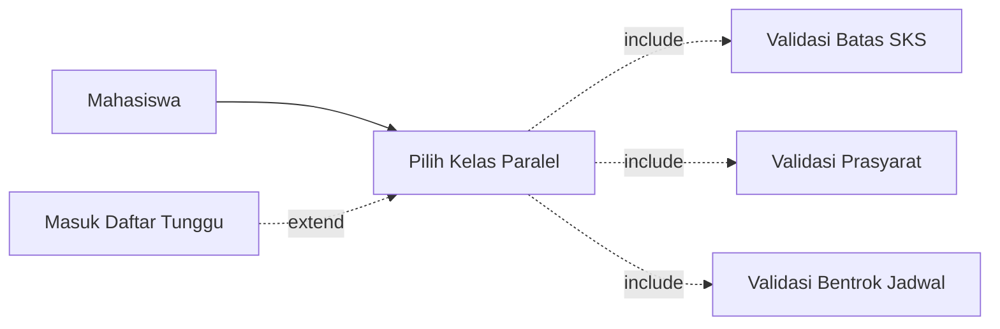
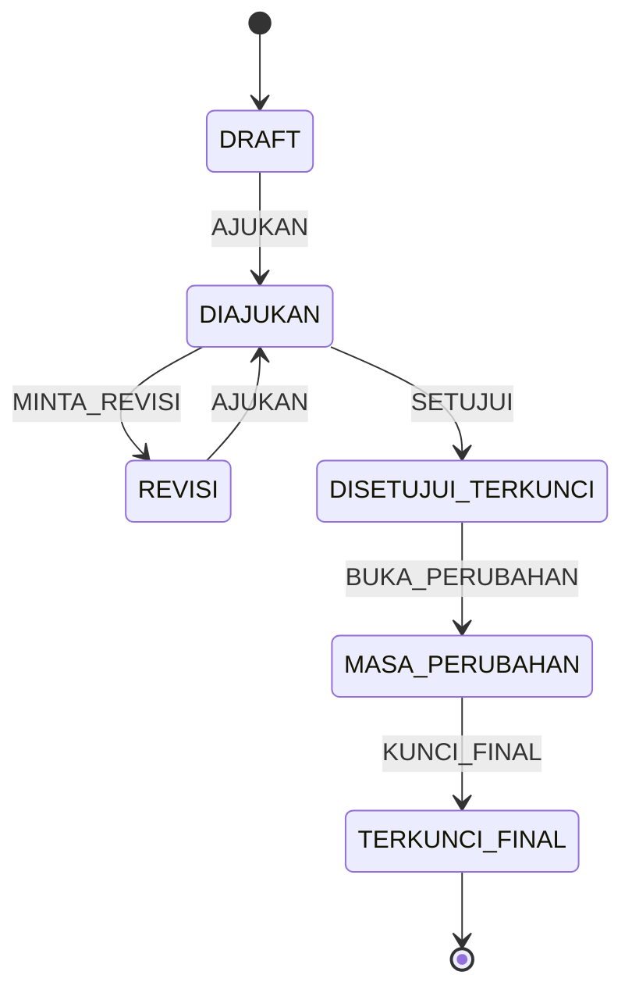

# KRSync — Tahap 1 Implementation Plan

> **For agentic workers:** REQUIRED SUB-SKILL: Use superpowers:subagent-driven-development (recommended) or superpowers:executing-plans to implement this plan task-by-task. Steps use checkbox (`- [ ]`) syntax for tracking.

**Goal:** Build the KRSync academic KRS system in Go using exactly the patterns taught in the Pemrograman Web lecture decks (stdlib `net/http`, `html/template`, `database/sql` + MySQL, layered handler/service/repository/model, session auth).

**Architecture:** Server-rendered monolith. `cmd/web/main.go` wires `*sql.DB` → repositories → services → handlers → `http.ServeMux`. Handlers speak HTTP only; services hold every business rule; repositories are the only place SQL exists. Five people work in parallel by feature ownership, not by layer.

**Tech Stack:** Go 1.24+, MySQL 8.0.16+, `github.com/go-sql-driver/mysql`, `github.com/joho/godotenv`, `golang.org/x/crypto/bcrypt`, `html/template`, plain `log`, `wgo` for hot reload.

**Spec:** `~/Downloads/faebb823-9cc1-4185-817d-f45b348f1902.pdf` (KRSync Tahap 1 task breakdown) + the 10 lecture decks (extracted text in `~/.cache/tmp/opencode/krsync_docs/`). Where the two disagree, the lecture decks win on *form* and the KRSync PDF wins on *scope*.

---

## Global Constraints

These apply to every task. Do not deviate without editing this section.

- **Go module:** `github.com/vaskoyudha/krsync`
- **Go version:** 1.24+ (`crypto/rand.Text()` needs 1.24; the lecture's 1.22 instruction is outdated).
- **DB:** MySQL only. `?` placeholders, never `$1`. DSN must include `parseTime=true&charset=utf8mb4`.
- **No ORM, no sqlc, no pgx, no chi, no gin, no HTMX, no React.** Stdlib + `database/sql` only. The course enforces this.
- **Naming:** repository methods `Semua`, `CariByID`, `Tambah`, `Ubah`, `Hapus`; handlers `FormTambah`, `FormEdit`, `Simpan`, `Update`, `Hapus`; form structs `XxxForm`; errors `model.ErrNotFound`, `service.ValidasiError`.
- **Layering:** `handler` never imports `database/sql`; `service` never imports `net/http`; only `repository` contains SQL.
- **PRG:** every successful POST ends with `http.Redirect(w, r, url, http.StatusSeeOther)`.
- **Templates:** when a task creates a template file, add its path to the `halaman` slice in `internal/handler/render.go`. `NewRenderer` parses with `template.Must`, so a missing file panics at startup.
- **Validation failures** re-render the same template with preserved values and HTTP 400 (form shape errors) or 422 (business-rule failures).
- **Master data is soft-deleted** (`deleted_at IS NULL` in every SELECT). Transaction data (`krs`, `krs_detail`, `daftar_tunggu`) is never deleted, only status-changed.
- **Money/grade columns** are `DECIMAL(3,2)`, never `FLOAT`; `nilai_indeks` and `ips_terakhir` are read into `float64` via `database/sql`.
- **Passing grade constant:** `NilaiLulus = 2.00`, defined once in `internal/model/konstanta.go`.
- **Commits:** conventional commits (`feat:`, `fix:`, `test:`, `chore:`), one task per commit minimum.

## Locked Decisions (the 8 blockers from the review)

| # | Decision | Value |
|---|---|---|
| 1 | Auth storage | One `users` table with `role`; profile rows reference it (`mahasiswa.user_id`, `dosen_wali.user_id`). No self-registration. |
| 2 | KRS status set | `DRAFT`, `DIAJUKAN`, `REVISI`, `DISETUJUI_TERKUNCI`, `MASA_PERUBAHAN`, `TERKUNCI_FINAL` (REVISI added). |
| 3 | `krs_detail.status_baris` | `AKTIF`, `DIBATALKAN` only; approval lives on `krs`. |
| 4 | `daftar_tunggu.status_antre` | `MENUNGGU`, `DIPROMOSIKAN`, `GAGAL`, `BATAL`. |
| 5 | FK naming | `id` for PK, `<nama_tabel>_id` for FK → `kelas_paralel_id`, never `kelas_id`. |
| 6 | Pass threshold | `nilai_indeks >= 2.00 AND is_final = 1`. |
| 7 | Prasyarat depth | Exactly two levels: `prasyarat_grup.grup_kondisi` (AND/OR) over `prasyarat_item` rows. No nesting. |
| 8 | Waitlist ordering | `ORDER BY daftar_tunggu.id` (insertion order), promoted inside a transaction with `FOR UPDATE`. |

## File Structure

```
krsync/
├── cmd/web/main.go                 # wiring only
├── db/
│   ├── schema.sql                  # full DDL (Task 2)
│   └── seed.sql                    # dummy data (Task 2 + Task 21)
├── internal/
│   ├── config/config.go
│   ├── model/
│   │   ├── konstanta.go            # NilaiLulus, status constants
│   │   ├── user.go                 # + ErrNotFound, ErrEmailTerpakai, ErrLoginGagal
│   │   ├── akademik.go             # Semester, Kurikulum, MataKuliah, Ekuivalensi, Prasyarat, KelasParalel
│   │   ├── mahasiswa.go            # Mahasiswa, DosenWali, RiwayatNilai
│   │   └── krs.go                  # KRS, KRSDetail, DaftarTunggu, RekapKelas
│   ├── repository/
│   │   ├── user.go  session.go
│   │   ├── semester.go  kurikulum.go  mata_kuliah.go
│   │   ├── prasyarat.go  ekuivalensi.go  kelas_paralel.go
│   │   ├── mahasiswa.go  dosen_wali.go  riwayat_nilai.go
│   │   ├── krs.go  krs_detail.go  daftar_tunggu.go
│   │   └── rekap.go
│   ├── service/
│   │   ├── auth.go
│   │   ├── validasi_sks.go  validasi_prasyarat.go  validasi_bentrok.go  validasi_nilai.go
│   │   ├── krs.go  waitlist.go  rekap.go
│   └── handler/
│       ├── render.go  halaman.go  auth.go
│       ├── admin_master.go  admin_rekap.go
│       ├── krs.go  dosen.go
│   └── middleware/
│       ├── logging.go  auth.go
├── templates/
│   ├── layout.html  header.html  sidebar.html  footer.html
│   ├── home.html
│   ├── auth/{login.html}
│   ├── admin/{semester,kurikulum,mk,kelas,prasyarat,nilai,rekap}.html
│   ├── mahasiswa/{dashboard,isi-krs,tunggu,lembar}.html
│   └── dosen/{bimbingan,detail}.html
├── public/style.css
├── .env.example
├── .gitignore
├── Makefile
└── go.mod
```

## Ownership Matrix

| Person | Owns (write access) | Reviews |
|---|---|---|
| Vasco | `cmd/web/main.go`, `internal/handler/{render,halaman,auth}.go`, `internal/service/auth.go`, `internal/repository/{user,session}.go`, `internal/middleware/auth.go`, `templates/`, `public/` | all templates |
| Ricky | `internal/service/validasi_*.go` + `_test.go`, `internal/model/konstanta.go` | business rules |
| Saghita | `internal/service/{krs,waitlist}.go`, `internal/repository/{krs,krs_detail,daftar_tunggu}.go`, `internal/model/krs.go`, `templates/mahasiswa/` | state machine |
| Fariz | `internal/model/{akademik,mahasiswa}.go`, `internal/repository/{semester,kurikulum,mata_kuliah,prasyarat,ekuivalensi,kelas_paralel,mahasiswa,dosen_wali,riwayat_nilai}.go`, `db/schema.sql` (master half), `db/seed.sql` (master half), `templates/admin/` | schema |
| Shofwan | `internal/repository/rekap.go`, `internal/service/rekap.go`, `internal/handler/{admin_rekap,dosen}.go`, PDF export, `db/schema.sql` (txn half), `db/seed.sql` (txn half), `Makefile`, CI | deployment |

`cmd/web/main.go` is Vasco's file; other people send a snippet in the PR description, Vasco merges the wiring.

## Per-Person Work Queue

Each row is that person's own ordered queue. You do not wait for a task owned by someone else unless it is listed in **Blocked by**.

### Vasco — shell, auth, templates (critical-path owner for Tasks 1–6)

| Order | Task | Blocked by | Deliverable |
|---|---|---|---|
| 1 | Task 0 (use case, CRUD matrix, sitemap) | — | `docs/design/{use-case,crud-matrix,sitemap}.md` |
| 2 | Task 1 skeleton + config + server | — | `cmd/web/main.go` runs |
| 3 | Task 3 renderer + layout | Task 1 | styled home page |
| 4 | Task 4 auth repo/service | Task 2 | login service compiles |
| 5 | Task 5 auth handler + middleware | Task 4 | login page + `RequireRole` |
| 6 | Task 6 wire auth | Task 5 | 3 roles can log in |
| 7 | Task 13 templates (admin) | Task 13 handler | six admin pages |
| 8 | Task 17 templates (mahasiswa) | Task 17 handler | four student pages |
| 9 | Task 18 templates (dosen) | Task 18 handler | two dosen pages |

### Ricky — rules engine (starts immediately, depends on nothing)

| Order | Task | Blocked by | Deliverable |
|---|---|---|---|
| 1 | Task 0 (test-scenario contribution) | — | rows for `docs/DEMO.md` |
| 2 | Task 7 SKS limit | — | `BatasSKS` + test |
| 3 | Task 8 prasyarat AND/OR | — | `CekPrasyarat` + test |
| 4 | Task 9 bentrok jadwal + ruangan | — | `BentrokJadwal` + test |
| 5 | Task 10 nilai terbaik + ekuivalensi | — | `NilaiTerbaik`, `PetaNilai` + tests |

Ricky is the only person who can start before the schema lands. His whole queue is `go test`-verifiable with no DB.

### Saghita — KRS lifecycle and waitlist

| Order | Task | Blocked by | Deliverable |
|---|---|---|---|
| 1 | Task 0 (state diagram) | — | `docs/design/state-diagram.md` |
| 2 | Task 14 KRS models + transaction repos | Task 2 | repositories compile |
| 3 | Task 15 KRS service + state machine | Tasks 10, 14 | `TransisiStatus` + orchestration |
| 4 | Task 16 waitlist promotion | Task 15 | transactional promotion |
| 5 | Task 17 handler | Task 15 | student routes |

### Fariz — schema and master data

| Order | Task | Blocked by | Deliverable |
|---|---|---|---|
| 1 | Task 0 (ERD + kamus data) | — | `docs/design/{erd,kamus-data}.md` |
| 2 | Task 2 master half of schema | Task 0 | master DDL |
| 3 | Task 11 master models + repos | Task 2 | three repositories |
| 4 | Task 12 remaining master repos | Task 2 | six repositories |
| 5 | Task 13 handler | Tasks 11, 12 | admin CRUD working |

### Shofwan — transactions, reporting, platform

| Order | Task | Blocked by | Deliverable |
|---|---|---|---|
| 1 | Task 0 (compile the six documents) | others' drafts | merged PDF/MD |
| 2 | Task 2 transaction half of schema + seed | Task 0 | txn DDL + seed |
| 3 | Task 1 Makefile + `.gitignore` + CI | — | `make dev`, `make test` |
| 4 | Task 18 dosen approval | Tasks 15, 17 | approve/revisi cycle |
| 5 | Task 19 recap | Task 11 | `/admin/rekap` |
| 6 | Task 20 printable KRS | Task 17 | print view |
| 7 | Task 21 seed matrix + smoke test | all | `docs/DEMO.md` green |

## What Runs in Parallel

```
Week 1   Vasco: 0→1→3          Ricky: 0→7→8→9→10
         Fariz: 0→2(master)    Shofwan: 0 + 1(Makefile) + 2(txn)
Week 2   Vasco: 4→5→6          Ricky: done (join Task 21 review)
         Fariz: 11→12→13       Saghita: 14→15
Week 3   Saghita: 16→17        Shofwan: 18→19→20
         Fariz: 13 finish       Vasco: 13/17/18 templates
Week 4   Everyone: Task 21 (seed matrix + DEMO.md), then phase gate
```

**Critical path:** `1 → 2 → 11/12 → 14 → 15 → 16 → 17 → 18 → 19 → 21`. Any delay on Fariz's Task 2 or Saghita's Task 15 pushes the whole gate.

**Rule:** a person whose queue is empty picks up review work, not someone else's file. The ownership matrix above is the write-access boundary.

## Git Workflow

- `main` is protected by agreement, not tooling: no direct pushes after Task 2.
- One branch per person per phase: `feat/vasco-auth`, `feat/ricky-validasi`, `feat/saghita-krs`, `feat/fariz-master`, `feat/shofwan-rekap`.
- Rebase on `main` before opening a PR. PR must show: task number, files touched, `go build ./...` output, `go test ./...` output.
- Never commit `.env`, `*.sqlite`, or the binary.

## Phase Overview

| Phase | Tasks | Gate |
|---|---|---|
| Design freeze | 0 | six documents merged; every sitemap page has a route |
| 0 — Foundation | 1–3 | `make dev` serves a styled empty page from MySQL |
| 1 — Auth | 4–6 | login as 3 roles, role middleware blocks the others |
| 2 — Rules engine | 7–10 | `go test ./internal/service/` green, no DB needed |
| 3 — Master data | 11–13 | Admin can CRUD every master table |
| 4 — KRS + waitlist | 14–17 | Student fills KRS, submits, gets waitlisted, seat promotes |
| 5 — Approval + report | 18–21 | Dosen approves/rejects; rekap + PDF render; seed demo works |

---

## Task 0: Freeze the Design Artifacts (whole team, per role)

**Files:**
- Create: `docs/design/use-case.md`, `crud-matrix.md`, `sitemap.md`, `state-diagram.md`, `erd.md`, `kamus-data.md`

**Interfaces:**
- Produces the contract every later task implements. If code and these files disagree, the design file wins or gets a deliberate amendment.

- [ ] **Step 1: Use case diagram (`use-case.md`)**

Mermaid, three actors (`Admin Prodi`, `Mahasiswa`, `Dosen Wali`) and the 17 FR. Mandatory relations:



The extend arrow points **from** the extending use case **to** the base. Getting this backwards is the most common UML error.

- [ ] **Step 2: CRUD matrix (`crud-matrix.md`)**

Fill this table exactly; it becomes the route + middleware map.

| Modul | Admin Prodi | Mahasiswa | Dosen Wali |
|---|---|---|---|
| Kurikulum | C R U D | R | R |
| Mata Kuliah | C R U D | R | R |
| Prasyarat / Ekuivalensi | C R U D | R | R |
| Kelas Paralel | C R U D | R | R |
| Riwayat Nilai | C R U D | R (sendiri) | R (bimbingan) |
| Pengisian KRS | R | C R U (DRAFT/REVISI) | R + setujui/revisi |
| Daftar Tunggu | R | R (sendiri) | R (bimbingan) |
| Rekap Kelas | R | — | R (bimbingan) |
| Semester / Periode | C R U | R | R |
| Pengguna / Akun | C R U (nonaktifkan) | — | — |

- [ ] **Step 3: Sitemap (`sitemap.md`)**

Copy the three menus from the KRSync PDF and attach the route path from this plan to each page. Every page name must map to exactly one route; a page with no route is a missing task.

- [ ] **Step 4: State diagram (`state-diagram.md`)**



Plus the two child dictionaries: `krs_detail.status_baris` (`AKTIF`, `DIBATALKAN`) and `daftar_tunggu.status_antre` (`MENUNGGU`, `DIPROMOSIKAN`, `GAGAL`, `BATAL`).

- [ ] **Step 5: ERD and data dictionary (`erd.md`, `kamus-data.md`)**

One row per column: `Tabel | Kolom | Tipe | Panjang | PK/FK | Nullable | Keterangan`. Source of truth is `db/schema.sql`; if they drift, fix the document in the same PR.

- [ ] **Step 6: Commit**

```bash
git add docs/design
git commit -m "docs(design): use case, CRUD matrix, sitemap, state diagram, ERD, data dictionary"
```

---

## Task 1: Repository Skeleton, Config, and HTTP Server (Vasco)

**Files:**
- Create: `go.mod` (via `go mod init`), `.env.example`, `.gitignore`, `Makefile`
- Create: `internal/config/config.go`
- Create: `internal/middleware/logging.go`
- Create: `cmd/web/main.go`

**Interfaces:**
- Produces: `config.Load() (config.Config, error)`, `config.Config{Addr, DBDSN, CookieSecure}`
- Produces: `middleware.Logging(next http.Handler) http.Handler`
- Produces: `bukaDB(dsn string) (*sql.DB, error)` in `main` (unexported)

- [ ] **Step 1: Initialise the module and dependencies**

```bash
cd /home/vyns/Documents/github/KRSync
go mod init github.com/vaskoyudha/krsync
go get github.com/go-sql-driver/mysql
go get github.com/joho/godotenv
go get golang.org/x/crypto/bcrypt
go install github.com/bokwoon95/wgo@latest
```

- [ ] **Step 2: Write `.env.example` and `.gitignore`**

`.env.example`:

```env
ADDR=:8080
DB_DSN=app:rahasia@tcp(127.0.0.1:3306)/krsync?parseTime=true&charset=utf8mb4
COOKIE_SECURE=false
```

`.gitignore`:

```gitignore
.env
/krsync
*.test
```

- [ ] **Step 3: Write `internal/config/config.go`**

```go
package config

import (
	"errors"
	"os"

	"github.com/joho/godotenv"
)

type Config struct {
	Addr         string
	DBDSN        string
	CookieSecure bool
}

func Load() (Config, error) {
	_ = godotenv.Load()

	cfg := Config{
		Addr:         getEnv("ADDR", ":8080"),
		DBDSN:        os.Getenv("DB_DSN"),
		CookieSecure: os.Getenv("COOKIE_SECURE") == "true",
	}
	if cfg.DBDSN == "" {
		return cfg, errors.New("DB_DSN belum di-set (cek file .env)")
	}
	return cfg, nil
}

func getEnv(key, def string) string {
	if v := os.Getenv(key); v != "" {
		return v
	}
	return def
}
```

- [ ] **Step 4: Write `internal/middleware/logging.go`**

```go
package middleware

import (
	"log"
	"net/http"
	"time"
)

func Logging(next http.Handler) http.Handler {
	return http.HandlerFunc(func(w http.ResponseWriter, r *http.Request) {
		mulai := time.Now()
		next.ServeHTTP(w, r)
		log.Printf("%s %s %v", r.Method, r.URL.Path, time.Since(mulai))
	})
}
```

- [ ] **Step 5: Write `cmd/web/main.go`**

```go
package main

import (
	"context"
	"database/sql"
	"log"
	"net/http"
	"time"

	_ "github.com/go-sql-driver/mysql"

	"github.com/vaskoyudha/krsync/internal/config"
	"github.com/vaskoyudha/krsync/internal/middleware"
)

func main() {
	cfg, err := config.Load()
	if err != nil {
		log.Fatal(err)
	}

	db, err := bukaDB(cfg.DBDSN)
	if err != nil {
		log.Fatal(err)
	}
	defer db.Close()

	mux := http.NewServeMux()
	mux.HandleFunc("GET /{$}", func(w http.ResponseWriter, r *http.Request) {
		w.Header().Set("Content-Type", "text/html; charset=utf-8")
		w.Write([]byte("<h1>KRSync</h1>"))
	})

	srv := &http.Server{
		Addr:              cfg.Addr,
		Handler:           middleware.Logging(mux),
		ReadHeaderTimeout: 5 * time.Second,
		ReadTimeout:       10 * time.Second,
		WriteTimeout:      30 * time.Second,
		IdleTimeout:       60 * time.Second,
	}

	log.Printf("server jalan di %s", cfg.Addr)
	log.Fatal(srv.ListenAndServe())
}

func bukaDB(dsn string) (*sql.DB, error) {
	db, err := sql.Open("mysql", dsn)
	if err != nil {
		return nil, err
	}

	ctx, cancel := context.WithTimeout(context.Background(), 5*time.Second)
	defer cancel()

	if err := db.PingContext(ctx); err != nil {
		db.Close()
		return nil, err
	}

	db.SetMaxOpenConns(25)
	db.SetMaxIdleConns(25)
	db.SetConnMaxLifetime(5 * time.Minute)

	log.Println("database terhubung")
	return db, nil
}
```

- [ ] **Step 6: Write the `Makefile`**

```makefile
.PHONY: dev build test db schema seed fmt lint

dev:
	wgo run -file .html -file .css ./cmd/web

build:
	go build -o krsync ./cmd/web

test:
	go test ./...

schema:
	mysql -u app -p krsync < db/schema.sql

seed:
	mysql -u app -p krsync < db/seed.sql

fmt:
	gofmt -w .

lint:
	go vet ./...
```

- [ ] **Step 7: Verify it builds and runs**

Run: `go build ./... && go vet ./...`
Expected: no output, exit 0.

Run: `make dev` with a local MySQL reachable at the DSN in `.env`
Expected: `database terhubung` then `server jalan di :8080`; `curl -i localhost:8080/` returns `200`.

- [ ] **Step 8: Commit**

```bash
git add go.mod go.sum .env.example .gitignore Makefile cmd internal
git commit -m "chore: scaffold Go module, config, logging middleware, HTTP server"
```

---

## Task 2: Database Schema and Seed Data (Fariz + Shofwan)

**Files:**
- Create: `db/schema.sql`
- Create: `db/seed.sql`

**Interfaces:**
- Produces: every table named in this plan, with the exact columns the repositories expect.

- [ ] **Step 1: Write `db/schema.sql` — auth and reference tables**

```sql
CREATE DATABASE IF NOT EXISTS krsync CHARACTER SET utf8mb4 COLLATE utf8mb4_unicode_ci;
USE krsync;

CREATE TABLE users (
    id            BIGINT AUTO_INCREMENT PRIMARY KEY,
    nama          VARCHAR(100) NOT NULL,
    email         VARCHAR(255) NOT NULL UNIQUE,
    password_hash VARCHAR(255) NOT NULL,
    role          VARCHAR(20)  NOT NULL,
    is_active     TINYINT(1)   NOT NULL DEFAULT 1,
    created_at    TIMESTAMP    NOT NULL DEFAULT CURRENT_TIMESTAMP,
    CONSTRAINT chk_users_role CHECK (role IN ('ADMIN_PRODI','MAHASISWA','DOSEN_WALI'))
) ENGINE=InnoDB DEFAULT CHARSET=utf8mb4;

CREATE TABLE sessions (
    token      VARCHAR(64) PRIMARY KEY,
    user_id    BIGINT NOT NULL,
    expires_at DATETIME NOT NULL,
    CONSTRAINT fk_sessions_user FOREIGN KEY (user_id) REFERENCES users(id) ON DELETE CASCADE
) ENGINE=InnoDB DEFAULT CHARSET=utf8mb4;

CREATE TABLE semester (
    id              BIGINT AUTO_INCREMENT PRIMARY KEY,
    tahun_ajaran    VARCHAR(9)  NOT NULL,
    periode         VARCHAR(10) NOT NULL,
    status_periode  VARCHAR(30) NOT NULL DEFAULT 'PENGISIAN_KRS',
    tanggal_mulai   DATE NOT NULL,
    tanggal_selesai DATE NOT NULL,
    created_at      TIMESTAMP NOT NULL DEFAULT CURRENT_TIMESTAMP,
    UNIQUE KEY uq_semester (tahun_ajaran, periode),
    CONSTRAINT chk_semester_periode CHECK (periode IN ('GANJIL','GENAP')),
    CONSTRAINT chk_semester_status CHECK (status_periode IN ('PENGISIAN_KRS','PERKULIAHAN','MASA_PERUBAHAN_KRS','SELESAI'))
) ENGINE=InnoDB DEFAULT CHARSET=utf8mb4;
```

- [ ] **Step 2: Write master-curriculum tables**

```sql
CREATE TABLE kurikulum (
    id          BIGINT AUTO_INCREMENT PRIMARY KEY,
    kode        VARCHAR(20)  NOT NULL UNIQUE,
    nama        VARCHAR(100) NOT NULL,
    tahun_mulai YEAR NOT NULL,
    is_active   TINYINT(1) NOT NULL DEFAULT 1,
    created_at  TIMESTAMP NOT NULL DEFAULT CURRENT_TIMESTAMP,
    updated_at  TIMESTAMP NULL,
    deleted_at  TIMESTAMP NULL
) ENGINE=InnoDB DEFAULT CHARSET=utf8mb4;

CREATE TABLE mata_kuliah (
    id           BIGINT AUTO_INCREMENT PRIMARY KEY,
    kurikulum_id BIGINT NOT NULL,
    kode         VARCHAR(20)  NOT NULL,
    nama         VARCHAR(120) NOT NULL,
    sks          TINYINT NOT NULL,
    semester_ke  TINYINT NOT NULL,
    created_at   TIMESTAMP NOT NULL DEFAULT CURRENT_TIMESTAMP,
    updated_at   TIMESTAMP NULL,
    deleted_at   TIMESTAMP NULL,
    UNIQUE KEY uq_mk (kurikulum_id, kode),
    CONSTRAINT fk_mk_kurikulum FOREIGN KEY (kurikulum_id) REFERENCES kurikulum(id),
    CONSTRAINT chk_mk_sks CHECK (sks BETWEEN 1 AND 6)
) ENGINE=InnoDB DEFAULT CHARSET=utf8mb4;

CREATE TABLE ekuivalensi_mk (
    id         BIGINT AUTO_INCREMENT PRIMARY KEY,
    mk_baru_id BIGINT NOT NULL,
    mk_lama_id BIGINT NOT NULL,
    created_at TIMESTAMP NOT NULL DEFAULT CURRENT_TIMESTAMP,
    UNIQUE KEY uq_ekuivalensi (mk_baru_id, mk_lama_id),
    CONSTRAINT fk_eku_baru FOREIGN KEY (mk_baru_id) REFERENCES mata_kuliah(id),
    CONSTRAINT fk_eku_lama FOREIGN KEY (mk_lama_id) REFERENCES mata_kuliah(id)
) ENGINE=InnoDB DEFAULT CHARSET=utf8mb4;

CREATE TABLE prasyarat_grup (
    id           BIGINT AUTO_INCREMENT PRIMARY KEY,
    mk_id        BIGINT NOT NULL,
    grup_kondisi VARCHAR(3) NOT NULL,
    created_at   TIMESTAMP NOT NULL DEFAULT CURRENT_TIMESTAMP,
    CONSTRAINT chk_grup_kondisi CHECK (grup_kondisi IN ('AND','OR')),
    CONSTRAINT fk_grup_mk FOREIGN KEY (mk_id) REFERENCES mata_kuliah(id) ON DELETE CASCADE
) ENGINE=InnoDB DEFAULT CHARSET=utf8mb4;

CREATE TABLE prasyarat_item (
    id              BIGINT AUTO_INCREMENT PRIMARY KEY,
    grup_id         BIGINT NOT NULL,
    mk_prasyarat_id BIGINT NOT NULL,
    nilai_min       DECIMAL(3,2) NOT NULL DEFAULT 2.00,
    CONSTRAINT fk_item_grup FOREIGN KEY (grup_id) REFERENCES prasyarat_grup(id) ON DELETE CASCADE,
    CONSTRAINT fk_item_mk   FOREIGN KEY (mk_prasyarat_id) REFERENCES mata_kuliah(id)
) ENGINE=InnoDB DEFAULT CHARSET=utf8mb4;
```

- [ ] **Step 3: Write people and academic-record tables**

```sql
CREATE TABLE dosen_wali (
    id      BIGINT AUTO_INCREMENT PRIMARY KEY,
    user_id BIGINT NOT NULL UNIQUE,
    nidn    VARCHAR(20)  NOT NULL UNIQUE,
    nama    VARCHAR(100) NOT NULL,
    CONSTRAINT fk_dosen_user FOREIGN KEY (user_id) REFERENCES users(id) ON DELETE CASCADE
) ENGINE=InnoDB DEFAULT CHARSET=utf8mb4;

CREATE TABLE mahasiswa (
    id            BIGINT AUTO_INCREMENT PRIMARY KEY,
    user_id       BIGINT NOT NULL UNIQUE,
    nim           VARCHAR(20)  NOT NULL UNIQUE,
    nama          VARCHAR(100) NOT NULL,
    angkatan      YEAR NOT NULL,
    kurikulum_id  BIGINT NOT NULL,
    dosen_wali_id BIGINT NULL,
    ips_terakhir  DECIMAL(3,2) NOT NULL DEFAULT 0.00,
    CONSTRAINT fk_mhs_user     FOREIGN KEY (user_id) REFERENCES users(id) ON DELETE CASCADE,
    CONSTRAINT fk_mhs_kurikulum FOREIGN KEY (kurikulum_id) REFERENCES kurikulum(id),
    CONSTRAINT fk_mhs_dosen    FOREIGN KEY (dosen_wali_id) REFERENCES dosen_wali(id)
) ENGINE=InnoDB DEFAULT CHARSET=utf8mb4;

CREATE TABLE riwayat_nilai (
    id           BIGINT AUTO_INCREMENT PRIMARY KEY,
    mahasiswa_id BIGINT NOT NULL,
    mk_id        BIGINT NOT NULL,
    semester_id  BIGINT NOT NULL,
    nilai_indeks DECIMAL(3,2) NOT NULL,
    nilai_huruf  VARCHAR(2) NOT NULL,
    is_final     TINYINT(1) NOT NULL DEFAULT 1,
    UNIQUE KEY uq_nilai (mahasiswa_id, mk_id, semester_id),
    KEY idx_nilai_mhs_mk (mahasiswa_id, mk_id),
    CONSTRAINT fk_nilai_mhs FOREIGN KEY (mahasiswa_id) REFERENCES mahasiswa(id),
    CONSTRAINT fk_nilai_mk  FOREIGN KEY (mk_id) REFERENCES mata_kuliah(id),
    CONSTRAINT fk_nilai_sem FOREIGN KEY (semester_id) REFERENCES semester(id)
) ENGINE=InnoDB DEFAULT CHARSET=utf8mb4;
```

- [ ] **Step 4: Write class and transaction tables**

```sql
CREATE TABLE kelas_paralel (
    id             BIGINT AUTO_INCREMENT PRIMARY KEY,
    mk_id          BIGINT NOT NULL,
    semester_id    BIGINT NOT NULL,
    kode_kelas     VARCHAR(10) NOT NULL,
    dosen_id       BIGINT NULL,
    hari           VARCHAR(7) NOT NULL,
    jam_mulai      TIME NOT NULL,
    jam_selesai    TIME NOT NULL,
    ruangan        VARCHAR(20) NOT NULL,
    kuota_maksimal SMALLINT NOT NULL,
    created_at     TIMESTAMP NOT NULL DEFAULT CURRENT_TIMESTAMP,
    updated_at     TIMESTAMP NULL,
    deleted_at     TIMESTAMP NULL,
    UNIQUE KEY uq_kelas (mk_id, semester_id, kode_kelas),
    KEY idx_kelas_sem (semester_id, mk_id),
    CONSTRAINT chk_kelas_hari  CHECK (hari IN ('SENIN','SELASA','RABU','KAMIS','JUMAT','SABTU')),
    CONSTRAINT chk_kelas_jam   CHECK (jam_mulai < jam_selesai),
    CONSTRAINT chk_kelas_kuota CHECK (kuota_maksimal > 0),
    CONSTRAINT fk_kelas_mk   FOREIGN KEY (mk_id) REFERENCES mata_kuliah(id),
    CONSTRAINT fk_kelas_sem  FOREIGN KEY (semester_id) REFERENCES semester(id),
    CONSTRAINT fk_kelas_dosen FOREIGN KEY (dosen_id) REFERENCES dosen_wali(id)
) ENGINE=InnoDB DEFAULT CHARSET=utf8mb4;

CREATE TABLE krs (
    id            BIGINT AUTO_INCREMENT PRIMARY KEY,
    mahasiswa_id  BIGINT NOT NULL,
    semester_id   BIGINT NOT NULL,
    status_krs    VARCHAR(25) NOT NULL DEFAULT 'DRAFT',
    total_sks     SMALLINT NOT NULL DEFAULT 0,
    catatan_dosen TEXT NULL,
    submitted_at  DATETIME NULL,
    approved_at   DATETIME NULL,
    created_at    TIMESTAMP NOT NULL DEFAULT CURRENT_TIMESTAMP,
    updated_at    TIMESTAMP NULL,
    UNIQUE KEY uq_krs (mahasiswa_id, semester_id),
    CONSTRAINT chk_krs_status CHECK (status_krs IN ('DRAFT','DIAJUKAN','REVISI','DISETUJUI_TERKUNCI','MASA_PERUBAHAN','TERKUNCI_FINAL')),
    CONSTRAINT fk_krs_mhs FOREIGN KEY (mahasiswa_id) REFERENCES mahasiswa(id),
    CONSTRAINT fk_krs_sem FOREIGN KEY (semester_id) REFERENCES semester(id)
) ENGINE=InnoDB DEFAULT CHARSET=utf8mb4;

CREATE TABLE krs_detail (
    id               BIGINT AUTO_INCREMENT PRIMARY KEY,
    krs_id           BIGINT NOT NULL,
    kelas_paralel_id BIGINT NOT NULL,
    status_baris     VARCHAR(15) NOT NULL DEFAULT 'AKTIF',
    created_at       TIMESTAMP NOT NULL DEFAULT CURRENT_TIMESTAMP,
    UNIQUE KEY uq_detail (krs_id, kelas_paralel_id),
    CONSTRAINT chk_detail_status CHECK (status_baris IN ('AKTIF','DIBATALKAN')),
    CONSTRAINT fk_detail_krs   FOREIGN KEY (krs_id) REFERENCES krs(id) ON DELETE CASCADE,
    CONSTRAINT fk_detail_kelas FOREIGN KEY (kelas_paralel_id) REFERENCES kelas_paralel(id)
) ENGINE=InnoDB DEFAULT CHARSET=utf8mb4;

CREATE TABLE daftar_tunggu (
    id               BIGINT AUTO_INCREMENT PRIMARY KEY,
    mahasiswa_id     BIGINT NOT NULL,
    kelas_paralel_id BIGINT NOT NULL,
    status_antre     VARCHAR(15) NOT NULL DEFAULT 'MENUNGGU',
    created_at       TIMESTAMP NOT NULL DEFAULT CURRENT_TIMESTAMP,
    KEY idx_antre_kelas (kelas_paralel_id, status_antre, id),
    KEY idx_antre_mhs   (mahasiswa_id),
    CONSTRAINT chk_antre_status CHECK (status_antre IN ('MENUNGGU','DIPROMOSIKAN','GAGAL','BATAL')),
    CONSTRAINT fk_antre_mhs   FOREIGN KEY (mahasiswa_id) REFERENCES mahasiswa(id),
    CONSTRAINT fk_antre_kelas FOREIGN KEY (kelas_paralel_id) REFERENCES kelas_paralel(id)
) ENGINE=InnoDB DEFAULT CHARSET=utf8mb4;
```

- [ ] **Step 5: Write `db/seed.sql` with the assignment's exact cases**

Seed must contain: 1 curriculum, the 4 named courses (`Basis Data`, `Pemrograman Web`, `Pemrograman Mobile`, `Basis Data Lanjut`), the prasyarat group `Basis Data DAN (Pemrograman Web ATAU Pemrograman Mobile)`, one `ekuivalensi_mk` pair, 4 students with IPS `3.25 / 2.75 / 2.10 / 1.80`, one fully-booked `kelas_paralel`.

```sql
INSERT INTO users (nama, email, password_hash, role) VALUES
('Admin Prodi', 'admin@krsync.test',  '$2a$10$REPLACE_WITH_BCRYPT_HASH', 'ADMIN_PRODI'),
('Dosen Wali A', 'dosen@krsync.test', '$2a$10$REPLACE_WITH_BCRYPT_HASH', 'DOSEN_WALI'),
('Budi Santoso', 'budi@krsync.test',  '$2a$10$REPLACE_WITH_BCRYPT_HASH', 'MAHASISWA');
```

Generate real hashes before committing:

```bash
cat > /tmp/hash.go <<'EOF'
package main
import ("fmt"; "golang.org/x/crypto/bcrypt")
func main() {
	for _, p := range []string{"admin123", "dosen123", "mhs123"} {
		h, _ := bcrypt.GenerateFromPassword([]byte(p), bcrypt.DefaultCost)
		fmt.Println(p, string(h))
	}
}
EOF
cd /tmp && go mod init hash >/dev/null 2>&1; go get golang.org/x/crypto/bcrypt >/dev/null 2>&1; go run hash.go
```

Then paste the three hashes into `seed.sql`.

- [ ] **Step 6: Apply and verify**

Run: `make schema && make seed`
Expected: no errors.

Run: `mysql -u app -p krsync -e "SHOW TABLES; SELECT COUNT(*) FROM mata_kuliah;"`
Expected: 12 tables; `mata_kuliah` count = 5 (4 named + 1 old-curriculum course for ekuivalensi).

- [ ] **Step 7: Commit**

```bash
git add db/schema.sql db/seed.sql
git commit -m "feat(db): schema and seed data for KRSync"
```

---

## Task 3: Template Renderer, Layout, and Static Files (Vasco)

**Files:**
- Create: `internal/handler/render.go`
- Create: `internal/handler/halaman.go`
- Create: `templates/layout.html`, `header.html`, `sidebar.html`, `footer.html`, `home.html`
- Create: `public/style.css`
- Modify: `cmd/web/main.go` (serve static, wire renderer)

**Interfaces:**
- Produces: `handler.NewRenderer() *Renderer`
- Produces: `(*Renderer).Tampil(w http.ResponseWriter, file string, data any)`
- Produces: `handler.HalamanHandler{View *Renderer}` with method `Home(w, r)`

- [ ] **Step 1: Write `internal/handler/render.go`**

```go
package handler

import (
	"bytes"
	"html/template"
	"log"
	"net/http"
)

type Renderer struct {
	tpl map[string]*template.Template
}

var funcs = template.FuncMap{
	"add_one": func(n int) int { return n + 1 },
}

func NewRenderer() *Renderer {
	// Setiap task yang menambah file template WAJIB menambahkan path-nya di sini.
	halaman := []string{
		"home.html",
	}

	rd := &Renderer{tpl: make(map[string]*template.Template)}
	for _, file := range halaman {
		rd.tpl[file] = template.Must(template.New("layout").Funcs(funcs).ParseFiles(
			"templates/layout.html",
			"templates/header.html",
			"templates/sidebar.html",
			"templates/footer.html",
			"templates/"+file,
		))
	}
	return rd
}

func (rd *Renderer) Tampil(w http.ResponseWriter, file string, data any) {
	var buf bytes.Buffer
	if err := rd.tpl[file].ExecuteTemplate(&buf, "layout", data); err != nil {
		log.Printf("render %s: %v", file, err)
		http.Error(w, "Terjadi kesalahan pada server", http.StatusInternalServerError)
		return
	}
	w.Header().Set("Content-Type", "text/html; charset=utf-8")
	buf.WriteTo(w)
}
```

- [ ] **Step 2: Write the shared layout templates**

`templates/layout.html`:

```html
{{define "layout"}}
<!DOCTYPE html>
<html lang="id">
<head>
  <meta charset="utf-8">
  <meta name="viewport" content="width=device-width, initial-scale=1">
  <title>{{.Title}} — KRSync</title>
  <link rel="stylesheet" href="/static/style.css">
</head>
<body>
  {{template "header" .}}
  <div class="shell">
    {{template "sidebar" .}}
    <main>{{template "content" .}}</main>
  </div>
  {{template "footer" .}}
</body>
</html>
{{end}}
```

`templates/header.html`:

```html
{{define "header"}}
<header class="topbar">
  <a class="brand" href="/">KRSync</a>
  {{with .User}}{{if .Nama}}<span class="who">{{.Nama}} · {{.Role}}</span>{{end}}{{end}}
</header>
{{end}}
```

`templates/sidebar.html`:

```html
{{define "sidebar"}}
<nav class="sidebar">
  {{with .User}}
  {{if eq .Role "ADMIN_PRODI"}}
    <a href="/admin/rekap">Rekap Kelas</a>
    <a href="/admin/semester">Semester</a>
    <a href="/admin/kurikulum">Kurikulum &amp; MK</a>
    <a href="/admin/prasyarat">Prasyarat &amp; Ekuivalensi</a>
    <a href="/admin/kelas">Kelas Paralel</a>
    <a href="/admin/nilai">Input Nilai</a>
  {{else if eq .Role "MAHASISWA"}}
    <a href="/krs">Dashboard Akademik</a>
    <a href="/krs/isi">Isi KRS</a>
    <a href="/krs/tunggu">Daftar Tunggu</a>
    <a href="/krs/lembar">Lembar KRS</a>
  {{else if eq .Role "DOSEN_WALI"}}
    <a href="/bimbingan">Mahasiswa Bimbingan</a>
  {{end}}
  <form method="post" action="/logout"><button class="btn btn-light" type="submit">Keluar</button></form>
  {{end}}
</nav>
{{end}}
```

`templates/footer.html`:

```html
{{define "footer"}}<footer class="foot">KRSync · Sistem KRS Prodi</footer>{{end}}
```

- [ ] **Step 3: Write `templates/home.html` and `public/style.css`**

`templates/home.html`:

```html
{{define "content"}}
<h1>Selamat datang{{with .User}}{{if .Nama}}, {{.Nama}}{{end}}{{end}}</h1>
<p>Gunakan menu di samping sesuai peran Anda.</p>
{{end}}
```

`public/style.css`: a small editorial stylesheet — system font stack, one accent colour, no framework. Minimum required selectors: `.topbar`, `.brand`, `.shell`, `.sidebar`, `.foot`, `.btn`, `.btn-light`, `.form`, `.form-group`, `table`.

- [ ] **Step 4: Write `internal/handler/halaman.go`**

```go
package handler

import "net/http"

type HalamanHandler struct {
	View *Renderer
}

func (h *HalamanHandler) Home(w http.ResponseWriter, r *http.Request) {
	h.View.Tampil(w, "home.html", map[string]any{"Title": "Beranda"})
}
```

- [ ] **Step 5: Wire renderer and static files in `cmd/web/main.go`**

Replace the inline `mux.HandleFunc("GET /{$}", ...)` block with:

```go
	view := handler.NewRenderer()
	halaman := &handler.HalamanHandler{View: view}

	mux := http.NewServeMux()
	mux.HandleFunc("GET /{$}", halaman.Home)
	mux.Handle("GET /static/", http.StripPrefix("/static/", http.FileServer(http.Dir("public"))))
```

Add `"github.com/vaskoyudha/krsync/internal/handler"` to imports.

- [ ] **Step 6: Verify**

Run: `go build ./... && make dev`
Expected: `curl -s localhost:8080/ | grep -q "KRSync"` exits 0; `curl -s -o /dev/null -w "%{http_code}" localhost:8080/static/style.css` prints `200`.

- [ ] **Step 7: Commit**

```bash
git add internal/handler templates public cmd/web/main.go
git commit -m "feat(web): template renderer, layout shell, static assets"
```

---

## Task 4: User and Session Repository + Auth Service (Vasco)

**Files:**
- Create: `internal/model/user.go`
- Create: `internal/repository/user.go`
- Create: `internal/repository/session.go`
- Create: `internal/service/auth.go`
- Test: `internal/service/auth_test.go`

**Interfaces:**
- Consumes: `*sql.DB`
- Produces: `repository.UserRepo{DB *sql.DB}` with `Tambah`, `HashByEmail`, `CariByID`
- Produces: `repository.SessionRepo{DB *sql.DB}` with `Buat`, `UserDariToken`, `Hapus`
- Produces: `service.AuthService{Users, Sessions}` with `Login`, `UserDariToken`, `Logout`
- Produces: `model.User{ID int64; Nama, Email, Role string}`

- [ ] **Step 1: Write `internal/model/user.go`**

```go
package model

import "errors"

var (
	ErrNotFound       = errors.New("data tidak ditemukan")
	ErrEmailTerpakai  = errors.New("email sudah terdaftar")
	ErrLoginGagal     = errors.New("email atau password salah")
	ErrAkunNonaktif   = errors.New("akun tidak aktif")
)

// User tidak memuat password hash, jadi aman dikirim ke handler dan template.
type User struct {
	ID    int64
	Nama  string
	Email string
	Role  string
}
```

- [ ] **Step 2: Write `internal/repository/user.go`**

```go
package repository

import (
	"context"
	"database/sql"
	"errors"
	"fmt"

	"github.com/go-sql-driver/mysql"

	"github.com/vaskoyudha/krsync/internal/model"
)

type UserRepo struct {
	DB *sql.DB
}

func (r *UserRepo) Tambah(ctx context.Context, nama, email, hash, role string) error {
	_, err := r.DB.ExecContext(ctx,
		"INSERT INTO users (nama, email, password_hash, role) VALUES (?, ?, ?, ?)",
		nama, email, hash, role)

	var me *mysql.MySQLError
	if errors.As(err, &me) && me.Number == 1062 {
		return model.ErrEmailTerpakai
	}
	if err != nil {
		return fmt.Errorf("tambah user: %w", err)
	}
	return nil
}

// HashByEmail hanya dipakai saat login.
func (r *UserRepo) HashByEmail(ctx context.Context, email string) (int64, string, bool, error) {
	var (
		id     int64
		hash   string
		active bool
	)
	err := r.DB.QueryRowContext(ctx,
		"SELECT id, password_hash, is_active FROM users WHERE email = ?", email,
	).Scan(&id, &hash, &active)

	if errors.Is(err, sql.ErrNoRows) {
		return 0, "", false, model.ErrNotFound
	}
	if err != nil {
		return 0, "", false, fmt.Errorf("cari user %s: %w", email, err)
	}
	return id, hash, active, nil
}

func (r *UserRepo) CariByID(ctx context.Context, id int64) (model.User, error) {
	var u model.User
	err := r.DB.QueryRowContext(ctx,
		"SELECT id, nama, email, role FROM users WHERE id = ? AND is_active = 1", id,
	).Scan(&u.ID, &u.Nama, &u.Email, &u.Role)

	if errors.Is(err, sql.ErrNoRows) {
		return u, model.ErrNotFound
	}
	if err != nil {
		return u, fmt.Errorf("cari user %d: %w", id, err)
	}
	return u, nil
}
```

- [ ] **Step 3: Write `internal/repository/session.go`**

```go
package repository

import (
	"context"
	"crypto/rand"
	"database/sql"
	"errors"
	"fmt"

	"github.com/vaskoyudha/krsync/internal/model"
)

type SessionRepo struct {
	DB *sql.DB
}

func (r *SessionRepo) Buat(ctx context.Context, userID int64) (string, error) {
	token := rand.Text()
	_, err := r.DB.ExecContext(ctx, `
		INSERT INTO sessions (token, user_id, expires_at)
		VALUES (?, ?, NOW() + INTERVAL 7 DAY)`, token, userID)
	if err != nil {
		return "", fmt.Errorf("buat session: %w", err)
	}
	return token, nil
}

func (r *SessionRepo) UserDariToken(ctx context.Context, token string) (model.User, error) {
	var u model.User
	err := r.DB.QueryRowContext(ctx, `
		SELECT u.id, u.nama, u.email, u.role
		FROM sessions s JOIN users u ON u.id = s.user_id
		WHERE s.token = ? AND s.expires_at > NOW() AND u.is_active = 1`, token,
	).Scan(&u.ID, &u.Nama, &u.Email, &u.Role)

	if errors.Is(err, sql.ErrNoRows) {
		return u, model.ErrNotFound
	}
	if err != nil {
		return u, fmt.Errorf("user dari token: %w", err)
	}
	return u, nil
}

func (r *SessionRepo) Hapus(ctx context.Context, token string) error {
	_, err := r.DB.ExecContext(ctx, "DELETE FROM sessions WHERE token = ?", token)
	return err
}
```

- [ ] **Step 4: Write `internal/service/auth.go`**

```go
package service

import (
	"context"
	"errors"
	"strings"

	"golang.org/x/crypto/bcrypt"

	"github.com/vaskoyudha/krsync/internal/model"
	"github.com/vaskoyudha/krsync/internal/repository"
)

type ValidasiError struct {
	Pesan string
}

func (e *ValidasiError) Error() string { return e.Pesan }

type AuthService struct {
	Users    *repository.UserRepo
	Sessions *repository.SessionRepo
}

func (s *AuthService) Login(ctx context.Context, email, password string) (string, error) {
	email = strings.ToLower(strings.TrimSpace(email))
	if email == "" || password == "" {
		return "", &ValidasiError{"Email dan password wajib diisi"}
	}

	id, hash, active, err := s.Users.HashByEmail(ctx, email)
	if errors.Is(err, model.ErrNotFound) {
		return "", model.ErrLoginGagal
	}
	if err != nil {
		return "", err
	}
	if !active {
		return "", model.ErrAkunNonaktif
	}
	if bcrypt.CompareHashAndPassword([]byte(hash), []byte(password)) != nil {
		return "", model.ErrLoginGagal
	}
	return s.Sessions.Buat(ctx, id)
}

func (s *AuthService) UserDariToken(ctx context.Context, token string) (model.User, error) {
	return s.Sessions.UserDariToken(ctx, token)
}

func (s *AuthService) Logout(ctx context.Context, token string) error {
	return s.Sessions.Hapus(ctx, token)
}
```

- [ ] **Step 5: Write the service test (no DB, no HTTP)**

`internal/service/auth_test.go`:

```go
package service

import (
	"context"
	"errors"
	"testing"

	"github.com/vaskoyudha/krsync/internal/model"
)

type fakeUserStore struct {
	hash   string
	active bool
	err    error
}

func (f fakeUserStore) HashByEmail(ctx context.Context, email string) (int64, string, bool, error) {
	return 1, f.hash, f.active, f.err
}

func TestLogin_EmptyInput(t *testing.T) {
	s := &AuthService{}
	_, err := s.Login(context.Background(), "", "")
	var ve *ValidasiError
	if !errors.As(err, &ve) {
		t.Fatalf("expected ValidasiError, got %v", err)
	}
}

func TestLogin_InactiveAccount(t *testing.T) {
	// guard: the service must not issue a session for an inactive user
	if model.ErrAkunNonaktif == nil {
		t.Fatal("ErrAkunNonaktif must be defined")
	}
}
```

> The injected-fake refactor is deliberately *not* done: the lecture uses concrete repos. `TestLogin_EmptyInput` covers the branch that needs no DB; the remaining branches are covered by the manual smoke test in Task 6.

- [ ] **Step 6: Run tests**

Run: `go test ./internal/service/ -run TestLogin -v`
Expected: PASS.

- [ ] **Step 7: Commit**

```bash
git add internal/model/user.go internal/repository/user.go internal/repository/session.go internal/service/auth.go internal/service/auth_test.go
git commit -m "feat(auth): user/session repository and login service"
```

---

## Task 5: Auth Handler, Login Template, and Role Middleware (Vasco)

**Files:**
- Create: `internal/middleware/auth.go`
- Create: `internal/handler/auth.go`
- Create: `templates/auth/login.html`

**Interfaces:**
- Consumes: `*service.AuthService`
- Produces: `middleware.Auth{Svc *service.AuthService}` with `RequireLogin`, `RequireRole`
- Produces: `middleware.UserDari(ctx) (model.User, bool)`
- Produces: `handler.AuthHandler{Svc, View, CookieSecure}` with `FormLogin`, `Login`, `Logout`

- [ ] **Step 1: Write `internal/middleware/auth.go`**

```go
package middleware

import (
	"context"
	"errors"
	"log"
	"net/http"

	"github.com/vaskoyudha/krsync/internal/model"
	"github.com/vaskoyudha/krsync/internal/service"
)

type ctxKey struct{}

type Auth struct {
	Svc *service.AuthService
}

func (a *Auth) RequireLogin(next http.Handler) http.Handler {
	return http.HandlerFunc(func(w http.ResponseWriter, r *http.Request) {
		c, err := r.Cookie("session")
		if err != nil {
			http.Redirect(w, r, "/login", http.StatusSeeOther)
			return
		}
		u, err := a.Svc.UserDariToken(r.Context(), c.Value)
		if errors.Is(err, model.ErrNotFound) {
			http.Redirect(w, r, "/login", http.StatusSeeOther)
			return
		}
		if err != nil {
			log.Printf("cek session: %v", err)
			http.Error(w, "Terjadi kesalahan pada server", http.StatusInternalServerError)
			return
		}
		ctx := context.WithValue(r.Context(), ctxKey{}, u)
		next.ServeHTTP(w, r.WithContext(ctx))
	})
}

// RequireRole harus dipasang SETELAH RequireLogin.
func (a *Auth) RequireRole(role string, next http.Handler) http.Handler {
	return http.HandlerFunc(func(w http.ResponseWriter, r *http.Request) {
		u, ok := UserDari(r.Context())
		if !ok || u.Role != role {
			http.Error(w, "Anda tidak berhak mengakses halaman ini", http.StatusForbidden)
			return
		}
		next.ServeHTTP(w, r)
	})
}

func UserDari(ctx context.Context) (model.User, bool) {
	u, ok := ctx.Value(ctxKey{}).(model.User)
	return u, ok
}
```

- [ ] **Step 2: Write `templates/auth/login.html`**

Add `"auth/login.html"` to the `halaman` slice in `internal/handler/render.go` when you create the file.

```html
{{define "content"}}
<section class="auth-card">
  <h1>Masuk KRSync</h1>
  {{if .Error}}<p class="error">{{.Error}}</p>{{end}}
  <form class="form" method="post" action="/login">
    <div class="form-group">
      <label for="email">Email</label>
      <input type="email" id="email" name="email" value="{{.Email}}" required autofocus>
    </div>
    <div class="form-group">
      <label for="password">Password</label>
      <input type="password" id="password" name="password" required>
    </div>
    <button class="btn" type="submit">Masuk</button>
  </form>
  <p class="hint">Akun dibuat oleh Admin Prodi. Tidak ada pendaftaran mandiri.</p>
</section>
{{end}}
```

- [ ] **Step 3: Write `internal/handler/auth.go`**

```go
package handler

import (
	"errors"
	"log"
	"net/http"

	"github.com/vaskoyudha/krsync/internal/model"
	"github.com/vaskoyudha/krsync/internal/service"
)

type AuthForm struct {
	Email  string
	Error  string
	User   model.User
	Title  string
}

type AuthHandler struct {
	Svc          *service.AuthService
	View         *Renderer
	CookieSecure bool
}

func (h *AuthHandler) FormLogin(w http.ResponseWriter, r *http.Request) {
	h.View.Tampil(w, "auth/login.html", AuthForm{Title: "Masuk"})
}

func (h *AuthHandler) Login(w http.ResponseWriter, r *http.Request) {
	email := r.PostFormValue("email")
	token, err := h.Svc.Login(r.Context(), email, r.PostFormValue("password"))

	if errors.Is(err, model.ErrLoginGagal) || errors.Is(err, model.ErrAkunNonaktif) {
		msg := "Email atau password salah"
		if errors.Is(err, model.ErrAkunNonaktif) {
			msg = "Akun tidak aktif, hubungi Admin Prodi"
		}
		w.WriteHeader(http.StatusUnauthorized)
		h.View.Tampil(w, "auth/login.html", AuthForm{Title: "Masuk", Email: email, Error: msg})
		return
	}
	var ve *service.ValidasiError
	if errors.As(err, &ve) {
		w.WriteHeader(http.StatusBadRequest)
		h.View.Tampil(w, "auth/login.html", AuthForm{Title: "Masuk", Email: email, Error: ve.Pesan})
		return
	}
	if err != nil {
		log.Printf("login: %v", err)
		http.Error(w, "Terjadi kesalahan pada server", http.StatusInternalServerError)
		return
	}

	http.SetCookie(w, &http.Cookie{
		Name:     "session",
		Value:    token,
		Path:     "/",
		MaxAge:   7 * 24 * 60 * 60,
		HttpOnly: true,
		Secure:   h.CookieSecure,
		SameSite: http.SameSiteLaxMode,
	})
	http.Redirect(w, r, "/", http.StatusSeeOther)
}

func (h *AuthHandler) Logout(w http.ResponseWriter, r *http.Request) {
	if c, err := r.Cookie("session"); err == nil {
		_ = h.Svc.Logout(r.Context(), c.Value)
	}
	http.SetCookie(w, &http.Cookie{Name: "session", Value: "", Path: "/", MaxAge: -1})
	http.Redirect(w, r, "/login", http.StatusSeeOther)
}
```

- [ ] **Step 4: Update `HalamanHandler.Home` to read the user from context**

```go
func (h *HalamanHandler) Home(w http.ResponseWriter, r *http.Request) {
	u, _ := middleware.UserDari(r.Context())
	h.View.Tampil(w, "home.html", map[string]any{"Title": "Beranda", "User": u})
}
```

Add `"github.com/vaskoyudha/krsync/internal/middleware"` to imports.

- [ ] **Step 5: Commit (wiring happens in Task 6)**

```bash
git add internal/middleware/auth.go internal/handler/auth.go internal/handler/halaman.go templates/auth
git commit -m "feat(auth): login handler, session cookie, role middleware"
```

---

## Task 6: Wire Auth Into main.go (Vasco)

**Files:**
- Modify: `cmd/web/main.go`

**Interfaces:**
- Consumes: everything produced by Tasks 4 and 5.

- [ ] **Step 1: Replace the mux section in `main.go`**

```go
	userRepo := &repository.UserRepo{DB: db}
	sessionRepo := &repository.SessionRepo{DB: db}
	authSvc := &service.AuthService{Users: userRepo, Sessions: sessionRepo}
	authH := &handler.AuthHandler{Svc: authSvc, View: view, CookieSecure: cfg.CookieSecure}
	authMw := &middleware.Auth{Svc: authSvc}

	// publik
	mux := http.NewServeMux()
	mux.HandleFunc("GET /login", authH.FormLogin)
	mux.HandleFunc("POST /login", authH.Login)
	mux.Handle("GET /static/", http.StripPrefix("/static/", http.FileServer(http.Dir("public"))))

	// privat: semua route yang wajib login
	privat := http.NewServeMux()
	privat.HandleFunc("GET /{$}", halaman.Home)
	privat.HandleFunc("POST /logout", authH.Logout)

	mux.Handle("/", authMw.RequireLogin(privat))
```

- [ ] **Step 2: Verify the whole login flow manually**

Run: `make dev`, then:

```bash
curl -i -c /tmp/krsync.jar -d 'email=admin@krsync.test&password=admin123' localhost:8080/login
curl -i -b /tmp/krsync.jar localhost:8080/
curl -i localhost:8080/          # tanpa cookie → 303 ke /login
```

Expected: POST returns `303` + `Set-Cookie: session=...; HttpOnly`; authenticated GET returns `200` with `Admin Prodi`; unauthenticated GET returns `303 Location: /login`.

- [ ] **Step 3: Commit**

```bash
git add cmd/web/main.go
git commit -m "feat(auth): wire login flow and protected mux"
```

---

## Task 7: SKS Limit Rule (Ricky)

**Files:**
- Create: `internal/model/konstanta.go`
- Create: `internal/service/validasi_sks.go`
- Test: `internal/service/validasi_sks_test.go`

**Interfaces:**
- Produces: `service.BatasSKS(ips float64) int`
- Produces: `model.NilaiLulus = 2.00`, `model.MaxSKS = 24`

- [ ] **Step 1: Write `internal/model/konstanta.go`**

```go
package model

const (
	NilaiLulus = 2.00
	MaxSKS     = 24
)
```

- [ ] **Step 2: Write the failing test**

```go
package service

import "testing"

func TestBatasSKS(t *testing.T) {
	cases := []struct {
		ips  float64
		want int
	}{
		{3.51, 24}, {3.00, 24}, {2.99, 21}, {2.50, 21},
		{2.49, 18}, {2.00, 18}, {1.99, 15}, {0.00, 15},
	}
	for _, c := range cases {
		if got := BatasSKS(c.ips); got != c.want {
			t.Errorf("BatasSKS(%.2f) = %d, want %d", c.ips, got, c.want)
		}
	}
}
```

- [ ] **Step 3: Run it and confirm failure**

Run: `go test ./internal/service/ -run TestBatasSKS -v`
Expected: FAIL, `undefined: BatasSKS`.

- [ ] **Step 4: Write `internal/service/validasi_sks.go`**

```go
package service

// BatasSKS mengikuti Aturan Bisnis KRSync: IPS >= 3.00 → 24 SKS,
// 2.50–2.99 → 21, 2.00–2.49 → 18, < 2.00 → 15.
func BatasSKS(ips float64) int {
	switch {
	case ips >= 3.00:
		return 24
	case ips >= 2.50:
		return 21
	case ips >= 2.00:
		return 18
	default:
		return 15
	}
}

func SKSMelebihi(totalSKS, tambahan, batas int) bool {
	return totalSKS+tambahan > batas
}
```

- [ ] **Step 5: Run and commit**

Run: `go test ./internal/service/ -run TestBatasSKS -v` → PASS.

```bash
git add internal/model/konstanta.go internal/service/validasi_sks.go internal/service/validasi_sks_test.go
git commit -m "feat(rules): SKS limit from IPS"
```

---

## Task 8: Prerequisite Evaluation, AND/OR (Ricky)

**Files:**
- Create: `internal/model/akademik.go` (prasyarat types only; Fariz extends it in Task 11)
- Create: `internal/service/validasi_prasyarat.go`
- Test: `internal/service/validasi_prasyarat_test.go`

**Interfaces:**
- Produces: `model.PrasyaratGrup{ID, MkID int64; Kondisi string; Items []PrasyaratItem}`
- Produces: `model.PrasyaratItem{MkID int64; NilaiMin float64; Nama string}`
- Produces: `service.HasilPrasyarat{Lolos bool; Kurang []string}`
- Produces: `service.CekPrasyarat(grup []model.PrasyaratGrup, nilai map[int64]float64) service.HasilPrasyarat`

- [ ] **Step 1: Add the types to `internal/model/akademik.go`**

```go
package model

type PrasyaratGrup struct {
	ID      int64
	MkID    int64
	Kondisi string // "AND" | "OR"
	Items   []PrasyaratItem
}

type PrasyaratItem struct {
	MkID      int64
	MkNama    string
	NilaiMin  float64
}
```

- [ ] **Step 2: Write the failing test**

```go
package service

import (
	"reflect"
	"testing"

	"github.com/vaskoyudha/krsync/internal/model"
)

func grupAnd(items ...model.PrasyaratItem) model.PrasyaratGrup {
	return model.PrasyaratGrup{ID: 1, Kondisi: "AND", Items: items}
}

func TestCekPrasyarat(t *testing.T) {
	// Basis Data DAN (Pemrograman Web ATAU Pemrograman Mobile)
	grup := []model.PrasyaratGrup{
		grupAnd(model.PrasyaratItem{MkID: 10, MkNama: "Basis Data", NilaiMin: 2.00}),
		{ID: 2, Kondisi: "OR", Items: []model.PrasyaratItem{
			{MkID: 20, MkNama: "Pemrograman Web", NilaiMin: 2.00},
			{MkID: 21, MkNama: "Pemrograman Mobile", NilaiMin: 2.00},
		}},
	}

	t.Run("lolos ketika semua grup terpenuhi", func(t *testing.T) {
		got := CekPrasyarat(grup, map[int64]float64{10: 3.00, 20: 2.75})
		if !got.Lolos || len(got.Kurang) != 0 {
			t.Fatalf("want lolos, got %+v", got)
		}
	})

	t.Run("lolos lewat cabang OR kedua", func(t *testing.T) {
		got := CekPrasyarat(grup, map[int64]float64{10: 2.00, 21: 2.50})
		if !got.Lolos {
			t.Fatalf("want lolos, got %+v", got)
		}
	})

	t.Run("gagal menyebut MK yang kurang", func(t *testing.T) {
		got := CekPrasyarat(grup, map[int64]float64{20: 3.00})
		if got.Lolos {
			t.Fatal("want gagal, got lolos")
		}
		want := []string{"Basis Data"}
		if !reflect.DeepEqual(got.Kurang, want) {
			t.Fatalf("Kurang = %v, want %v", got.Kurang, want)
		}
	})

	t.Run("nilai di bawah batas dianggap tidak lulus", func(t *testing.T) {
		got := CekPrasyarat(grup, map[int64]float64{10: 1.99, 20: 3.00})
		if got.Lolos {
			t.Fatal("want gagal, got lolos")
		}
	})
}
```

- [ ] **Step 3: Run it and confirm failure**

Run: `go test ./internal/service/ -run TestCekPrasyarat -v`
Expected: FAIL, `undefined: CekPrasyarat`.

- [ ] **Step 4: Write `internal/service/validasi_prasyarat.go`**

```go
package service

import (
	"fmt"

	"github.com/vaskoyudha/krsync/internal/model"
)

type HasilPrasyarat struct {
	Lolos  bool
	Kurang []string
}

// CekPrasyarat mengevaluasi dua tingkat: grup_kondisi (AND/OR) di tingkat
// grup, dan setiap item di dalam grup harus >= NilaiMin.
// nilai adalah peta mk_id → nilai_indeks terbaik mahasiswa.
func CekPrasyarat(grup []model.PrasyaratGrup, nilai map[int64]float64) HasilPrasyarat {
	var kurang []string

	for _, g := range grup {
		var gagalGrup []string
		for _, it := range g.Items {
			n, ada := nilai[it.MkID]
			if !ada || n < it.NilaiMin {
				gagalGrup = append(gagalGrup, it.MkNama)
			}
		}

		switch g.Kondisi {
		case "OR":
			// grup OR gagal hanya kalau SEMUA item gagal
			if len(gagalGrup) == len(g.Items) {
				kurang = append(kurang, gagalGrup...)
			}
		default: // AND
			kurang = append(kurang, gagalGrup...)
		}
	}

	return HasilPrasyarat{Lolos: len(kurang) == 0, Kurang: kurang}
}

func (h HasilPrasyarat) Pesan() string {
	if h.Lolos {
		return ""
	}
	return fmt.Sprintf("Prasyarat belum terpenuhi: %v", h.Kurang)
}
```

- [ ] **Step 5: Run and commit**

Run: `go test ./internal/service/ -run TestCekPrasyarat -v` → PASS.

```bash
git add internal/model/akademik.go internal/service/validasi_prasyarat.go internal/service/validasi_prasyarat_test.go
git commit -m "feat(rules): two-level AND/OR prerequisite evaluation"
```

---

## Task 9: Schedule Conflict Detection (Ricky)

**Files:**
- Create: `internal/service/validasi_bentrok.go`
- Test: `internal/service/validasi_bentrok_test.go`
- Add to `internal/model/akademik.go`: `KelasParalel`

**Interfaces:**
- Produces: `model.KelasParalel{ID, MkID int64; KodeKelas, Hari, Ruangan string; JamMulai, JamSelesai string; KuotaMaksimal int}`
- Produces: `service.BentrokJadwal(kandidat model.KelasParalel, diambil []model.KelasParalel) []model.KelasParalel`
- Produces: `service.BentrokRuangan(kandidat model.KelasParalel, sekelas []model.KelasParalel) []model.KelasParalel`

- [ ] **Step 1: Add `KelasParalel` to `internal/model/akademik.go`**

```go
type KelasParalel struct {
	ID             int64
	MkID           int64
	MkNama         string
	SemesterID     int64
	KodeKelas      string
	DosenID        int64
	Hari           string
	JamMulai       string // "HH:MM"
	JamSelesai     string // "HH:MM"
	Ruangan        string
	KuotaMaksimal  int
	JumlahTerisi   int
}
```

> Times stay as `"HH:MM"` strings because MySQL `TIME` scans into `[]byte`/`string` with `parseTime=true`; comparison is safe lexicographically for zero-padded 24-hour values. If the team prefers, scan into `time.Duration` — do not mix both.

- [ ] **Step 2: Write the failing test**

```go
package service

import (
	"testing"

	"github.com/vaskoyudha/krsync/internal/model"
)

func kp(id int64, hari, mulai, selesai, ruang string) model.KelasParalel {
	return model.KelasParalel{ID: id, Hari: hari, JamMulai: mulai, JamSelesai: selesai, Ruangan: ruang}
}

func TestBentrokJadwal(t *testing.T) {
	kandidat := kp(9, "SENIN", "08:00", "09:40", "A101")

	t.Run("tidak bentrok beda hari", func(t *testing.T) {
		if got := BentrokJadwal(kandidat, []model.KelasParalel{kp(1, "SELASA", "08:00", "09:40", "B201")}); len(got) != 0 {
			t.Fatalf("want no conflict, got %v", got)
		}
	})

	t.Run("bentrok overlap parsial", func(t *testing.T) {
		if got := BentrokJadwal(kandidat, []model.KelasParalel{kp(2, "SENIN", "09:00", "10:40", "C301")}); len(got) != 1 {
			t.Fatalf("want 1 conflict, got %v", got)
		}
	})

	t.Run("bersambung tepat tidak bentrok", func(t *testing.T) {
		if got := BentrokJadwal(kandidat, []model.KelasParalel{kp(3, "SENIN", "09:40", "11:20", "C301")}); len(got) != 0 {
			t.Fatalf("want no conflict, got %v", got)
		}
	})

	t.Run("bentrok identik", func(t *testing.T) {
		if got := BentrokJadwal(kandidat, []model.KelasParalel{kp(4, "SENIN", "08:00", "09:40", "D401")}); len(got) != 1 {
			t.Fatalf("want 1 conflict, got %v", got)
		}
	})
}

func TestBentrokRuangan(t *testing.T) {
	kandidat := kp(9, "SENIN", "08:00", "09:40", "A101")
	bentrok := BentrokRuangan(kandidat, []model.KelasParalel{kp(5, "SENIN", "08:30", "10:00", "A101")})
	if len(bentrok) != 1 {
		t.Fatalf("want 1 room conflict, got %v", bentrok)
	}
}
```

- [ ] **Step 3: Run it and confirm failure**

Run: `go test ./internal/service/ -run 'TestBentrok' -v`
Expected: FAIL, undefined functions.

- [ ] **Step 4: Write `internal/service/validasi_bentrok.go`**

```go
package service

import "github.com/vaskoyudha/krsync/internal/model"

func overlap(a, b model.KelasParalel) bool {
	return a.JamMulai < b.JamSelesai && a.JamSelesai > b.JamMulai
}

// BentrokJadwal mengembalikan kelas yang beririsan waktunya pada hari yang sama.
func BentrokJadwal(kandidat model.KelasParalel, diambil []model.KelasParalel) []model.KelasParalel {
	var hasil []model.KelasParalel
	for _, k := range diambil {
		if k.ID == kandidat.ID {
			continue
		}
		if k.Hari == kandidat.Hari && overlap(kandidat, k) {
			hasil = append(hasil, k)
		}
	}
	return hasil
}

// BentrokRuangan memeriksa pemakaian ruangan yang sama pada waktu beririsan.
func BentrokRuangan(kandidat model.KelasParalel, sekelas []model.KelasParalel) []model.KelasParalel {
	var hasil []model.KelasParalel
	for _, k := range sekelas {
		if k.ID == kandidat.ID {
			continue
		}
		if k.Ruangan == kandidat.Ruangan && k.Hari == kandidat.Hari && overlap(kandidat, k) {
			hasil = append(hasil, k)
		}
	}
	return hasil
}
```

- [ ] **Step 5: Run and commit**

Run: `go test ./internal/service/ -run 'TestBentrok' -v` → PASS.

```bash
git add internal/model/akademik.go internal/service/validasi_bentrok.go internal/service/validasi_bentrok_test.go
git commit -m "feat(rules): schedule and room conflict detection"
```

---

## Task 10: Best Grade Across Curriculum Equivalence (Ricky)

**Files:**
- Create: `internal/model/mahasiswa.go` (RiwayatNilai only; Fariz extends in Task 11)
- Create: `internal/service/validasi_nilai.go`
- Test: `internal/service/validasi_nilai_test.go`

**Interfaces:**
- Produces: `model.RiwayatNilai{MkID int64; NilaiIndeks float64; IsFinal bool}`
- Produces: `service.NilaiTerbaik(riwayat []model.RiwayatNilai, mkID int64, ekuivalen []int64) (float64, bool)`
- Produces: `service.PetaNilai(riwayat []model.RiwayatNilai) map[int64]float64`

- [ ] **Step 1: Add `RiwayatNilai` to `internal/model/mahasiswa.go`**

```go
package model

type RiwayatNilai struct {
	ID          int64
	MahasiswaID int64
	MkID        int64
	MkNama      string
	NilaiIndeks float64
	NilaiHuruf  string
	IsFinal     bool
}
```

- [ ] **Step 2: Write the failing test**

```go
package service

import (
	"testing"

	"github.com/vaskoyudha/krsync/internal/model"
)

func TestNilaiTerbaik(t *testing.T) {
	riwayat := []model.RiwayatNilai{
		{MkID: 10, NilaiIndeks: 2.00, IsFinal: true}, // MK baru
		{MkID: 90, NilaiIndeks: 3.50, IsFinal: true}, // MK lama, ekuivalen
		{MkID: 91, NilaiIndeks: 4.00, IsFinal: false}, // belum final, harus diabaikan
	}

	t.Run("ambil nilai tertinggi termasuk ekuivalensi", func(t *testing.T) {
		n, ok := NilaiTerbaik(riwayat, 10, []int64{90})
		if !ok || n != 3.50 {
			t.Fatalf("want 3.50 ok, got %.2f %v", n, ok)
		}
	})

	t.Run("abaikan nilai non-final", func(t *testing.T) {
		n, _ := NilaiTerbaik(riwayat, 10, []int64{91})
		if n == 4.00 {
			t.Fatal("nilai non-final tidak boleh dipakai")
		}
	})

	t.Run("tanpa riwayat", func(t *testing.T) {
		if _, ok := NilaiTerbaik(riwayat, 77, nil); ok {
			t.Fatal("want not ok")
		}
	})
}

func TestPetaNilai(t *testing.T) {
	p := PetaNilai([]model.RiwayatNilai{
		{MkID: 10, NilaiIndeks: 2.75, IsFinal: true},
		{MkID: 10, NilaiIndeks: 3.25, IsFinal: true},
		{MkID: 10, NilaiIndeks: 4.00, IsFinal: false},
	})
	if p[10] != 3.25 {
		t.Fatalf("want best 3.25, got %.2f", p[10])
	}
}
```

- [ ] **Step 3: Run it and confirm failure**

Run: `go test ./internal/service/ -run 'TestNilaiTerbaik|TestPetaNilai' -v`
Expected: FAIL, undefined.

- [ ] **Step 4: Write `internal/service/validasi_nilai.go`**

```go
package service

import "github.com/vaskoyudha/krsync/internal/model"

// NilaiTerbaik mencari nilai_indeks final tertinggi untuk sebuah MK,
// termasuk nilai dari MK lama yang ekuivalen (kurikulum lama).
func NilaiTerbaik(riwayat []model.RiwayatNilai, mkID int64, ekuivalen []int64) (float64, bool) {
	relevan := map[int64]bool{mkID: true}
	for _, e := range ekuivalen {
		relevan[e] = true
	}

	best, ada := 0.0, false
	for _, r := range riwayat {
		if !r.IsFinal || !relevan[r.MkID] {
			continue
		}
		if !ada || r.NilaiIndeks > best {
			best, ada = r.NilaiIndeks, true
		}
	}
	return best, ada
}

// PetaNilai memetakan mk_id → nilai final tertinggi, dipakai CekPrasyarat.
func PetaNilai(riwayat []model.RiwayatNilai) map[int64]float64 {
	peta := make(map[int64]float64)
	for _, r := range riwayat {
		if !r.IsFinal {
			continue
		}
		if v, ok := peta[r.MkID]; !ok || r.NilaiIndeks > v {
			peta[r.MkID] = r.NilaiIndeks
		}
	}
	return peta
}
```

- [ ] **Step 5: Run the full rules suite and commit**

Run: `go test ./internal/service/ -v`
Expected: all Task 7–10 tests PASS, total 4 test functions minimum.

```bash
git add internal/model/mahasiswa.go internal/service/validasi_nilai.go internal/service/validasi_nilai_test.go
git commit -m "feat(rules): best grade across curriculum equivalence"
```

---

## Task 11: Master Models and Core Repositories (Fariz)

**Files:**
- Modify: `internal/model/akademik.go` (add `Semester`, `Kurikulum`, `MataKuliah`, `Ekuivalensi`)
- Modify: `internal/model/mahasiswa.go` (add `Mahasiswa`, `DosenWali`)
- Create: `internal/repository/semester.go`, `kurikulum.go`, `mata_kuliah.go`

**Interfaces:**
- Produces: models used by every later task (exact field lists below)
- Produces: `SemesterRepo`, `KurikulumRepo`, `MataKuliahRepo` each with `Semua`, `CariByID`, `Tambah`, `Ubah`, `Hapus`

- [ ] **Step 1: Add the remaining master structs**

`internal/model/akademik.go` additions:

```go
type Semester struct {
	ID             int64
	TahunAjaran    string
	Periode        string
	StatusPeriode  string
	TanggalMulai   string
	TanggalSelesai string
}

type Kurikulum struct {
	ID         int64
	Kode       string
	Nama       string
	TahunMulai int
	IsActive   bool
}

type MataKuliah struct {
	ID          int64
	KurikulumID int64
	Kode        string
	Nama        string
	SKS         int
	SemesterKe  int
}

type Ekuivalensi struct {
	ID      int64
	MkBaruID int64
	MkLamaID int64
}
```

`internal/model/mahasiswa.go` additions:

```go
type Mahasiswa struct {
	ID           int64
	UserID       int64
	NIM          string
	Nama         string
	Angkatan     int
	KurikulumID  int64
	DosenWaliID  int64
	IPSTerakhir  float64
}

type DosenWali struct {
	ID     int64
	UserID int64
	NIDN   string
	Nama   string
}
```

- [ ] **Step 2: Write `internal/repository/semester.go`**

```go
package repository

import (
	"context"
	"database/sql"
	"errors"
	"fmt"

	"github.com/vaskoyudha/krsync/internal/model"
)

type SemesterRepo struct {
	DB *sql.DB
}

const kolomSemester = `id, tahun_ajaran, periode, status_periode,
	DATE_FORMAT(tanggal_mulai,'%Y-%m-%d'), DATE_FORMAT(tanggal_selesai,'%Y-%m-%d')`

func (r *SemesterRepo) Semua(ctx context.Context) ([]model.Semester, error) {
	rows, err := r.DB.QueryContext(ctx,
		"SELECT "+kolomSemester+" FROM semester ORDER BY tahun_ajaran DESC, periode")
	if err != nil {
		return nil, fmt.Errorf("daftar semester: %w", err)
	}
	defer rows.Close()

	var hasil []model.Semester
	for rows.Next() {
		var s model.Semester
		if err := rows.Scan(&s.ID, &s.TahunAjaran, &s.Periode, &s.StatusPeriode, &s.TanggalMulai, &s.TanggalSelesai); err != nil {
			return nil, fmt.Errorf("scan semester: %w", err)
		}
		hasil = append(hasil, s)
	}
	return hasil, rows.Err()
}

func (r *SemesterRepo) CariByID(ctx context.Context, id int64) (model.Semester, error) {
	var s model.Semester
	err := r.DB.QueryRowContext(ctx,
		"SELECT "+kolomSemester+" FROM semester WHERE id = ?", id,
	).Scan(&s.ID, &s.TahunAjaran, &s.Periode, &s.StatusPeriode, &s.TanggalMulai, &s.TanggalSelesai)

	if errors.Is(err, sql.ErrNoRows) {
		return s, model.ErrNotFound
	}
	if err != nil {
		return s, fmt.Errorf("cari semester %d: %w", id, err)
	}
	return s, nil
}

func (r *SemesterRepo) Aktif(ctx context.Context) (model.Semester, error) {
	var s model.Semester
	err := r.DB.QueryRowContext(ctx, `
		SELECT `+kolomSemester+` FROM semester
		WHERE status_periode <> 'SELESAI'
		ORDER BY tahun_ajaran DESC, periode DESC LIMIT 1`,
	).Scan(&s.ID, &s.TahunAjaran, &s.Periode, &s.StatusPeriode, &s.TanggalMulai, &s.TanggalSelesai)

	if errors.Is(err, sql.ErrNoRows) {
		return s, model.ErrNotFound
	}
	if err != nil {
		return s, fmt.Errorf("semester aktif: %w", err)
	}
	return s, nil
}

func (r *SemesterRepo) Tambah(ctx context.Context, s model.Semester) (int64, error) {
	res, err := r.DB.ExecContext(ctx, `
		INSERT INTO semester (tahun_ajaran, periode, status_periode, tanggal_mulai, tanggal_selesai)
		VALUES (?, ?, ?, ?, ?)`,
		s.TahunAjaran, s.Periode, s.StatusPeriode, s.TanggalMulai, s.TanggalSelesai)
	if err != nil {
		return 0, fmt.Errorf("tambah semester: %w", err)
	}
	return res.LastInsertId()
}

func (r *SemesterRepo) UbahStatus(ctx context.Context, id int64, status string) error {
	res, err := r.DB.ExecContext(ctx,
		"UPDATE semester SET status_periode = ? WHERE id = ?", status, id)
	if err != nil {
		return fmt.Errorf("ubah status semester %d: %w", id, err)
	}
	return pastikanAdaBaris(res)
}
```

- [ ] **Step 3: Write `internal/repository/kurikulum.go` and `mata_kuliah.go`**

Follow the same shape as `SemesterRepo`. Required methods:

```go
type KurikulumRepo struct{ DB *sql.DB }
func (r *KurikulumRepo) Semua(ctx context.Context) ([]model.Kurikulum, error)
func (r *KurikulumRepo) CariByID(ctx context.Context, id int64) (model.Kurikulum, error)
func (r *KurikulumRepo) Tambah(ctx context.Context, k model.Kurikulum) (int64, error)
func (r *KurikulumRepo) Ubah(ctx context.Context, k model.Kurikulum) error
func (r *KurikulumRepo) Hapus(ctx context.Context, id int64) error   // soft delete

type MataKuliahRepo struct{ DB *sql.DB }
func (r *MataKuliahRepo) Semua(ctx context.Context, kurikulumID int64) ([]model.MataKuliah, error)
func (r *MataKuliahRepo) CariByID(ctx context.Context, id int64) (model.MataKuliah, error)
func (r *MataKuliahRepo) Tambah(ctx context.Context, m model.MataKuliah) (int64, error)
func (r *MataKuliahRepo) Ubah(ctx context.Context, m model.MataKuliah) error
func (r *MataKuliahRepo) Hapus(ctx context.Context, id int64) error   // soft delete
```

Every SELECT for `kurikulum` and `mata_kuliah` must include `AND deleted_at IS NULL`. Every `Ubah`/`Hapus` ends with `return pastikanAdaBaris(res)`.

- [ ] **Step 4: Add the shared `pastikanAdaBaris` helper**

`internal/repository/helper.go`:

```go
package repository

import (
	"database/sql"

	"github.com/vaskoyudha/krsync/internal/model"
)

func pastikanAdaBaris(res sql.Result) error {
	n, err := res.RowsAffected()
	if err != nil {
		return err
	}
	if n == 0 {
		return model.ErrNotFound
	}
	return nil
}
```

- [ ] **Step 5: Verify compilation and commit**

Run: `go build ./...`
Expected: exit 0.

```bash
git add internal/model internal/repository
git commit -m "feat(master): semester, kurikulum, mata kuliah repositories"
```

---

## Task 12: Prerequisite, Equivalence, Class, Student, and Grade Repositories (Fariz)

**Files:**
- Create: `internal/repository/prasyarat.go`, `ekuivalensi.go`, `kelas_paralel.go`, `mahasiswa.go`, `dosen_wali.go`, `riwayat_nilai.go`

**Interfaces:**
- Produces: `PrasyaratRepo.GrupUntukMK(ctx, mkID) ([]model.PrasyaratGrup, error)`
- Produces: `EkuivalensiRepo.UntukMK(ctx, mkID) ([]int64, error)`
- Produces: `KelasParalelRepo.Semua(ctx, semesterID) ([]model.KelasParalel, error)`, `CariByID`, `JumlahTerisi(ctx, kelasID) (int, error)`, `KelasDiambil(ctx, krsID) ([]model.KelasParalel, error)`
- Produces: `MahasiswaRepo.CariByUserID(ctx, userID) (model.Mahasiswa, error)`, `Bimbingan(ctx, dosenID) ([]model.Mahasiswa, error)`
- Produces: `RiwayatNilaiRepo.Semua(ctx, mahasiswaID) ([]model.RiwayatNilai, error)`

- [ ] **Step 1: `internal/repository/prasyarat.go`**

```go
package repository

import (
	"context"
	"database/sql"
	"fmt"

	"github.com/vaskoyudha/krsync/internal/model"
)

type PrasyaratRepo struct {
	DB *sql.DB
}

// GrupUntukMK mengembalikan grup beserta item-nya, sudah dikelompokkan.
func (r *PrasyaratRepo) GrupUntukMK(ctx context.Context, mkID int64) ([]model.PrasyaratGrup, error) {
	rows, err := r.DB.QueryContext(ctx, `
		SELECT g.id, g.grup_kondisi, i.mk_prasyarat_id, mk.nama, i.nilai_min
		FROM prasyarat_grup g
		JOIN prasyarat_item i ON i.grup_id = g.id
		JOIN mata_kuliah mk ON mk.id = i.mk_prasyarat_id
		WHERE g.mk_id = ?
		ORDER BY g.id, i.id`, mkID)
	if err != nil {
		return nil, fmt.Errorf("prasyarat mk %d: %w", mkID, err)
	}
	defer rows.Close()

	var hasil []model.PrasyaratGrup
	for rows.Next() {
		var (
			grupID   int64
			kondisi  string
			itemMK   int64
			itemNama string
			nilaiMin float64
		)
		if err := rows.Scan(&grupID, &kondisi, &itemMK, &itemNama, &nilaiMin); err != nil {
			return nil, fmt.Errorf("scan prasyarat: %w", err)
		}

		item := model.PrasyaratItem{MkID: itemMK, MkNama: itemNama, NilaiMin: nilaiMin}
		if n := len(hasil); n > 0 && hasil[n-1].ID == grupID {
			hasil[n-1].Items = append(hasil[n-1].Items, item)
			continue
		}
		hasil = append(hasil, model.PrasyaratGrup{ID: grupID, MkID: mkID, Kondisi: kondisi, Items: []model.PrasyaratItem{item}})
	}
	return hasil, rows.Err()
}
```

- [ ] **Step 2: `internal/repository/ekuivalensi.go`**

```go
package repository

import (
	"context"
	"database/sql"
	"fmt"
)

type EkuivalensiRepo struct {
	DB *sql.DB
}

// UntukMK mengembalikan semua mk_lama_id yang setara dengan mkID.
func (r *EkuivalensiRepo) UntukMK(ctx context.Context, mkID int64) ([]int64, error) {
	rows, err := r.DB.QueryContext(ctx,
		"SELECT mk_lama_id FROM ekuivalensi_mk WHERE mk_baru_id = ?", mkID)
	if err != nil {
		return nil, fmt.Errorf("ekuivalensi mk %d: %w", mkID, err)
	}
	defer rows.Close()

	var hasil []int64
	for rows.Next() {
		var id int64
		if err := rows.Scan(&id); err != nil {
			return nil, fmt.Errorf("scan ekuivalensi: %w", err)
		}
		hasil = append(hasil, id)
	}
	return hasil, rows.Err()
}

// PetaSemua mengembalikan peta mk_baru_id → []mk_lama_id untuk seluruh kurikulum.
// Dipakai validasi prasyarat agar nilai MK lama ikut dihitung.
func (r *EkuivalensiRepo) PetaSemua(ctx context.Context) (map[int64][]int64, error) {
	rows, err := r.DB.QueryContext(ctx,
		"SELECT mk_baru_id, mk_lama_id FROM ekuivalensi_mk")
	if err != nil {
		return nil, fmt.Errorf("peta ekuivalensi: %w", err)
	}
	defer rows.Close()

	peta := make(map[int64][]int64)
	for rows.Next() {
		var baru, lama int64
		if err := rows.Scan(&baru, &lama); err != nil {
			return nil, fmt.Errorf("scan ekuivalensi: %w", err)
		}
		peta[baru] = append(peta[baru], lama)
	}
	return peta, rows.Err()
}
```

- [ ] **Step 3: `internal/repository/kelas_paralel.go`**

```go
package repository

import (
	"context"
	"database/sql"
	"errors"
	"fmt"

	"github.com/vaskoyudha/krsync/internal/model"
)

type KelasParalelRepo struct {
	DB *sql.DB
}

const kolomKelas = `k.id, k.mk_id, mk.nama, k.semester_id, k.kode_kelas, COALESCE(k.dosen_id,0),
	k.hari, TIME_FORMAT(k.jam_mulai,'%H:%i'), TIME_FORMAT(k.jam_selesai,'%H:%i'),
	k.ruangan, k.kuota_maksimal`

func scanKelas(rows interface{ Scan(...any) error }) (model.KelasParalel, error) {
	var k model.KelasParalel
	err := rows.Scan(&k.ID, &k.MkID, &k.MkNama, &k.SemesterID, &k.KodeKelas, &k.DosenID,
		&k.Hari, &k.JamMulai, &k.JamSelesai, &k.Ruangan, &k.KuotaMaksimal)
	return k, err
}

func (r *KelasParalelRepo) Semua(ctx context.Context, semesterID int64) ([]model.KelasParalel, error) {
	rows, err := r.DB.QueryContext(ctx, `
		SELECT `+kolomKelas+`
		FROM kelas_paralel k
		JOIN mata_kuliah mk ON mk.id = k.mk_id
		WHERE k.semester_id = ? AND k.deleted_at IS NULL
		ORDER BY mk.nama, k.kode_kelas`, semesterID)
	if err != nil {
		return nil, fmt.Errorf("daftar kelas: %w", err)
	}
	defer rows.Close()

	var hasil []model.KelasParalel
	for rows.Next() {
		k, err := scanKelas(rows)
		if err != nil {
			return nil, fmt.Errorf("scan kelas: %w", err)
		}
		hasil = append(hasil, k)
	}
	return hasil, rows.Err()
}

func (r *KelasParalelRepo) CariByID(ctx context.Context, id int64) (model.KelasParalel, error) {
	row := r.DB.QueryRowContext(ctx, `
		SELECT `+kolomKelas+`
		FROM kelas_paralel k
		JOIN mata_kuliah mk ON mk.id = k.mk_id
		WHERE k.id = ? AND k.deleted_at IS NULL`, id)

	k, err := scanKelas(row)
	if errors.Is(err, sql.ErrNoRows) {
		return k, model.ErrNotFound
	}
	if err != nil {
		return k, fmt.Errorf("cari kelas %d: %w", id, err)
	}
	return k, nil
}

func (r *KelasParalelRepo) JumlahTerisi(ctx context.Context, kelasID int64) (int, error) {
	var n int
	err := r.DB.QueryRowContext(ctx, `
		SELECT COUNT(*) FROM krs_detail
		WHERE kelas_paralel_id = ? AND status_baris = 'AKTIF'`, kelasID).Scan(&n)
	if err != nil {
		return 0, fmt.Errorf("jumlah terisi kelas %d: %w", kelasID, err)
	}
	return n, nil
}

func (r *KelasParalelRepo) KelasDiambil(ctx context.Context, krsID int64) ([]model.KelasParalel, error) {
	rows, err := r.DB.QueryContext(ctx, `
		SELECT `+kolomKelas+`
		FROM krs_detail d
		JOIN kelas_paralel k ON k.id = d.kelas_paralel_id
		JOIN mata_kuliah mk ON mk.id = k.mk_id
		WHERE d.krs_id = ? AND d.status_baris = 'AKTIF'`, krsID)
	if err != nil {
		return nil, fmt.Errorf("kelas diambil: %w", err)
	}
	defer rows.Close()

	var hasil []model.KelasParalel
	for rows.Next() {
		k, err := scanKelas(rows)
		if err != nil {
			return nil, fmt.Errorf("scan kelas diambil: %w", err)
		}
		hasil = append(hasil, k)
	}
	return hasil, rows.Err()
}
```

- [ ] **Step 4: `internal/repository/mahasiswa.go`, `dosen_wali.go`, `riwayat_nilai.go`**

Required methods, same shape:

```go
type MahasiswaRepo struct{ DB *sql.DB }
func (r *MahasiswaRepo) CariByUserID(ctx context.Context, userID int64) (model.Mahasiswa, error)
func (r *MahasiswaRepo) CariByID(ctx context.Context, id int64) (model.Mahasiswa, error)
func (r *MahasiswaRepo) Semua(ctx context.Context) ([]model.Mahasiswa, error)
func (r *MahasiswaRepo) Bimbingan(ctx context.Context, dosenID int64) ([]model.Mahasiswa, error)
func (r *MahasiswaRepo) UbahIPS(ctx context.Context, id int64, ips float64) error

type DosenWaliRepo struct{ DB *sql.DB }
func (r *DosenWaliRepo) CariByUserID(ctx context.Context, userID int64) (model.DosenWali, error)
func (r *DosenWaliRepo) Semua(ctx context.Context) ([]model.DosenWali, error)

type RiwayatNilaiRepo struct{ DB *sql.DB }
func (r *RiwayatNilaiRepo) Semua(ctx context.Context, mahasiswaID int64) ([]model.RiwayatNilai, error)
func (r *RiwayatNilaiRepo) Simpan(ctx context.Context, n model.RiwayatNilai) error
```

`RiwayatNilaiRepo.Semua` query:

```sql
SELECT r.id, r.mahasiswa_id, r.mk_id, mk.nama, r.nilai_indeks, r.nilai_huruf, r.is_final
FROM riwayat_nilai r
JOIN mata_kuliah mk ON mk.id = r.mk_id
WHERE r.mahasiswa_id = ?
ORDER BY mk.nama
```

- [ ] **Step 5: Verify and commit**

Run: `go build ./...`
Expected: exit 0.

```bash
git add internal/repository
git commit -m "feat(master): prerequisite, equivalence, class, student, grade repositories"
```

---

## Task 13: Admin Master CRUD Pages (Fariz + Vasco templates)

**Files:**
- Create: `internal/handler/admin_master.go`
- Create: `templates/admin/{semester,kurikulum,mk,kelas,prasyarat,nilai}.html`

**Interfaces:**
- Consumes: all repos from Tasks 11–12
- Produces: `handler.AdminMasterHandler{...}` with methods listed below
- Produces routes (registered by Vasco in `main.go`):

```
GET  /admin/semester            POST /admin/semester
GET  /admin/kurikulum           POST /admin/kurikulum
GET  /admin/kurikulum/{id}/edit POST /admin/kurikulum/{id}/edit
GET  /admin/mk                  POST /admin/mk
GET  /admin/mk/{id}/edit        POST /admin/mk/{id}/edit
GET  /admin/kelas               POST /admin/kelas
GET  /admin/prasyarat           POST /admin/prasyarat
GET  /admin/nilai               POST /admin/nilai
```

- [ ] **Step 1: Write the handler skeleton**

```go
package handler

import (
	"net/http"

	"github.com/vaskoyudha/krsync/internal/repository"
	"github.com/vaskoyudha/krsync/internal/service"
)

type AdminMasterHandler struct {
	View       *Renderer
	Semester   *repository.SemesterRepo
	Kurikulum  *repository.KurikulumRepo
	MK         *repository.MataKuliahRepo
	Prasyarat  *repository.PrasyaratRepo
	Ekuivalensi *repository.EkuivalensiRepo
	Kelas      *repository.KelasParalelRepo
	Mahasiswa  *repository.MahasiswaRepo
	Nilai      *repository.RiwayatNilaiRepo
	Validasi   *service.ValidasiService
}
```

- [ ] **Step 2: Implement the read pages first**

Each list handler follows exactly this shape (the lecture's `Daftar` pattern):

```go
func (h *AdminMasterHandler) DaftarSemester(w http.ResponseWriter, r *http.Request) {
	u, _ := middleware.UserDari(r.Context())
	daftar, err := h.Semester.Semua(r.Context())
	if err != nil {
		gagal(w, err)
		return
	}
	h.View.Tampil(w, "admin/semester.html", map[string]any{
		"Title": "Semester", "User": u, "Daftar": daftar,
	})
}
```

Repeat for `DaftarKurikulum`, `DaftarMK`, `DaftarKelas`, `DaftarPrasyarat`, `DaftarNilai`. Every page passes `Title`, `User`, and its list.

- [ ] **Step 3: Implement create/update handlers**

One representative implementation (kurikulum); copy the shape for the rest with the fields of that entity:

```go
func (h *AdminMasterHandler) SimpanKurikulum(w http.ResponseWriter, r *http.Request) {
	k := model.Kurikulum{
		Kode:       r.PostFormValue("kode"),
		Nama:       r.PostFormValue("nama"),
		TahunMulai: atoiDefault(r.PostFormValue("tahun_mulai"), 0),
		IsActive:   r.PostFormValue("is_active") == "1",
	}
	if _, err := h.Kurikulum.Tambah(r.Context(), k); err != nil {
		gagal(w, err)
		return
	}
	http.Redirect(w, r, "/admin/kurikulum", http.StatusSeeOther)
}
```

- [ ] **Step 4: Add the shared handler helpers**

`internal/handler/helper.go`:

```go
package handler

import (
	"errors"
	"log"
	"net/http"
	"strconv"

	"github.com/vaskoyudha/krsync/internal/model"
	"github.com/vaskoyudha/krsync/internal/service"
)

func atoiDefault(s string, def int) int {
	n, err := strconv.Atoi(s)
	if err != nil {
		return def
	}
	return n
}

func idDariPath(w http.ResponseWriter, r *http.Request) (int64, bool) {
	id, err := strconv.ParseInt(r.PathValue("id"), 10, 64)
	if err != nil || id <= 0 {
		http.Error(w, "ID tidak valid", http.StatusBadRequest)
		return 0, false
	}
	return id, true
}

func gagal(w http.ResponseWriter, err error) {
	var ve *service.ValidasiError
	switch {
	case errors.As(err, &ve):
		http.Error(w, ve.Pesan, http.StatusBadRequest)
	case errors.Is(err, model.ErrNotFound):
		http.Error(w, "Data tidak ditemukan", http.StatusNotFound)
	default:
		log.Printf("error: %v", err)
		http.Error(w, "Terjadi kesalahan pada server", http.StatusInternalServerError)
	}
}
```

- [ ] **Step 5: Write the six templates**

Each is a `{{define "content"}}` block with a table of existing rows plus an inline create form posting to its route. The `nilai` template additionally has a `mahasiswa_id` select, `mk_id` select, `nilai_indeks` and `nilai_huruf` inputs.

Add all six paths to the `halaman` slice in `render.go`.

- [ ] **Step 6: Verify and commit**

Run: `go build ./...`
Expected: exit 0.

Manual: log in as `admin@krsync.test`, open each `/admin/*` page, create one row per table, confirm it appears in the list.

```bash
git add internal/handler/admin_master.go internal/handler/helper.go templates/admin
git commit -m "feat(admin): master data CRUD pages"
```

---

## Task 14: KRS Models and Transaction Repositories (Saghita)

**Files:**
- Create: `internal/model/krs.go`
- Create: `internal/repository/krs.go`, `krs_detail.go`, `daftar_tunggu.go`

**Interfaces:**
- Produces: `model.KRS`, `model.KRSDetail`, `model.DaftarTunggu`, `model.RekapKelas`
- Produces: `KRSRepo.CariAktif(ctx, mahasiswaID, semesterID) (model.KRS, error)`
- Produces: `KRSRepo.Tambah(ctx, mahasiswaID, semesterID) (int64, error)`
- Produces: `KRSRepo.UbahStatus(ctx, id int64, dari, ke string) error` (guard on `dari`)
- Produces: `KRSRepo.UbahTotalSKS(ctx, id int64, total int) error`
- Produces: `KRSDetailRepo.Tambah(ctx, krsID, kelasID) error`, `Hapus(ctx, krsID, kelasID) error`, `Semua(ctx, krsID) ([]model.KRSDetail, error)`
- Produces: `DaftarTungguRepo.Antre(ctx, mahasiswaID, kelasID) error`, `SemuaMilik(ctx, mahasiswaID) ([]model.DaftarTunggu, error)`

- [ ] **Step 1: Write `internal/model/krs.go`**

```go
package model

const (
	StatusDraft       = "DRAFT"
	StatusDiajukan    = "DIAJUKAN"
	StatusRevisi      = "REVISI"
	StatusDisetujui   = "DISETUJUI_TERKUNCI"
	StatusPerubahan   = "MASA_PERUBAHAN"
	StatusFinal       = "TERKUNCI_FINAL"

	BarisAktif    = "AKTIF"
	BarisBatal    = "DIBATALKAN"

	AntreMenunggu    = "MENUNGGU"
	AntreDipromosikan = "DIPROMOSIKAN"
	AntreGagal       = "GAGAL"
	AntreBatal       = "BATAL"
)

type KRS struct {
	ID           int64
	MahasiswaID  int64
	SemesterID   int64
	StatusKRS    string
	TotalSKS     int
	CatatanDosen string
}

type KRSDetail struct {
	ID             int64
	KRSID          int64
	KelasParalelID int64
	StatusBaris    string
	MkNama         string
	KodeKelas      string
	SKS            int
}

type DaftarTunggu struct {
	ID             int64
	MahasiswaID    int64
	KelasParalelID int64
	StatusAntre    string
	MkNama         string
	KodeKelas      string
}

type RekapKelas struct {
	KelasParalelID int64
	MkNama         string
	KodeKelas      string
	Ruangan        string
	KuotaMaksimal  int
	JumlahTerisi   int
	JumlahMenunggu int
}
```

- [ ] **Step 2: Write `internal/repository/krs.go`**

```go
package repository

import (
	"context"
	"database/sql"
	"errors"
	"fmt"

	"github.com/vaskoyudha/krsync/internal/model"
)

type KRSRepo struct {
	DB *sql.DB
}

func (r *KRSRepo) CariAktif(ctx context.Context, mahasiswaID, semesterID int64) (model.KRS, error) {
	var k model.KRS
	err := r.DB.QueryRowContext(ctx, `
		SELECT id, mahasiswa_id, semester_id, status_krs, total_sks, COALESCE(catatan_dosen,'')
		FROM krs WHERE mahasiswa_id = ? AND semester_id = ?`, mahasiswaID, semesterID,
	).Scan(&k.ID, &k.MahasiswaID, &k.SemesterID, &k.StatusKRS, &k.TotalSKS, &k.CatatanDosen)

	if errors.Is(err, sql.ErrNoRows) {
		return k, model.ErrNotFound
	}
	if err != nil {
		return k, fmt.Errorf("cari krs: %w", err)
	}
	return k, nil
}

func (r *KRSRepo) Tambah(ctx context.Context, mahasiswaID, semesterID int64) (int64, error) {
	res, err := r.DB.ExecContext(ctx,
		"INSERT INTO krs (mahasiswa_id, semester_id, status_krs) VALUES (?, ?, 'DRAFT')",
		mahasiswaID, semesterID)
	if err != nil {
		return 0, fmt.Errorf("tambah krs: %w", err)
	}
	return res.LastInsertId()
}

// UbahStatus hanya berhasil kalau status saat ini = dari (optimistic guard).
func (r *KRSRepo) UbahStatus(ctx context.Context, id int64, dari, ke string) error {
	res, err := r.DB.ExecContext(ctx,
		"UPDATE krs SET status_krs = ?, updated_at = NOW() WHERE id = ? AND status_krs = ?",
		ke, id, dari)
	if err != nil {
		return fmt.Errorf("ubah status krs %d: %w", id, err)
	}
	return pastikanAdaBaris(res)
}

func (r *KRSRepo) UbahTotalSKS(ctx context.Context, id int64, total int) error {
	res, err := r.DB.ExecContext(ctx,
		"UPDATE krs SET total_sks = ?, updated_at = NOW() WHERE id = ?", total, id)
	if err != nil {
		return fmt.Errorf("ubah total sks %d: %w", id, err)
	}
	return pastikanAdaBaris(res)
}
```

- [ ] **Step 3: Write `internal/repository/krs_detail.go`**

```go
package repository

import (
	"context"
	"database/sql"
	"fmt"

	"github.com/vaskoyudha/krsync/internal/model"
)

type KRSDetailRepo struct {
	DB *sql.DB
}

func (r *KRSDetailRepo) Tambah(ctx context.Context, krsID, kelasID int64) error {
	_, err := r.DB.ExecContext(ctx,
		"INSERT INTO krs_detail (krs_id, kelas_paralel_id, status_baris) VALUES (?, ?, 'AKTIF')",
		krsID, kelasID)
	if err != nil {
		return fmt.Errorf("tambah krs_detail: %w", err)
	}
	return nil
}

func (r *KRSDetailRepo) Hapus(ctx context.Context, krsID, kelasID int64) error {
	res, err := r.DB.ExecContext(ctx,
		"DELETE FROM krs_detail WHERE krs_id = ? AND kelas_paralel_id = ?", krsID, kelasID)
	if err != nil {
		return fmt.Errorf("hapus krs_detail: %w", err)
	}
	return pastikanAdaBaris(res)
}

func (r *KRSDetailRepo) Semua(ctx context.Context, krsID int64) ([]model.KRSDetail, error) {
	rows, err := r.DB.QueryContext(ctx, `
		SELECT d.id, d.krs_id, d.kelas_paralel_id, d.status_baris, mk.nama, k.kode_kelas, mk.sks
		FROM krs_detail d
		JOIN kelas_paralel k ON k.id = d.kelas_paralel_id
		JOIN mata_kuliah mk ON mk.id = k.mk_id
		WHERE d.krs_id = ?
		ORDER BY mk.nama`, krsID)
	if err != nil {
		return nil, fmt.Errorf("daftar krs_detail: %w", err)
	}
	defer rows.Close()

	var hasil []model.KRSDetail
	for rows.Next() {
		var d model.KRSDetail
		if err := rows.Scan(&d.ID, &d.KRSID, &d.KelasParalelID, &d.StatusBaris, &d.MkNama, &d.KodeKelas, &d.SKS); err != nil {
			return nil, fmt.Errorf("scan krs_detail: %w", err)
		}
		hasil = append(hasil, d)
	}
	return hasil, rows.Err()
}
```

- [ ] **Step 4: Write `internal/repository/daftar_tunggu.go`**

```go
package repository

import (
	"context"
	"database/sql"
	"fmt"

	"github.com/vaskoyudha/krsync/internal/model"
)

type DaftarTungguRepo struct {
	DB *sql.DB
}

func (r *DaftarTungguRepo) Antre(ctx context.Context, mahasiswaID, kelasID int64) error {
	var n int
	err := r.DB.QueryRowContext(ctx, `
		SELECT COUNT(*) FROM daftar_tunggu
		WHERE mahasiswa_id = ? AND kelas_paralel_id = ? AND status_antre = 'MENUNGGU'`,
		mahasiswaID, kelasID).Scan(&n)
	if err != nil {
		return fmt.Errorf("cek antre: %w", err)
	}
	if n > 0 {
		return nil // sudah mengantre, idempoten
	}

	_, err = r.DB.ExecContext(ctx,
		"INSERT INTO daftar_tunggu (mahasiswa_id, kelas_paralel_id, status_antre) VALUES (?, ?, 'MENUNGGU')",
		mahasiswaID, kelasID)
	if err != nil {
		return fmt.Errorf("masuk antre: %w", err)
	}
	return nil
}

func (r *DaftarTungguRepo) SemuaMilik(ctx context.Context, mahasiswaID int64) ([]model.DaftarTunggu, error) {
	rows, err := r.DB.QueryContext(ctx, `
		SELECT t.id, t.mahasiswa_id, t.kelas_paralel_id, t.status_antre, mk.nama, k.kode_kelas
		FROM daftar_tunggu t
		JOIN kelas_paralel k ON k.id = t.kelas_paralel_id
		JOIN mata_kuliah mk ON mk.id = k.mk_id
		WHERE t.mahasiswa_id = ?
		ORDER BY t.id`, mahasiswaID)
	if err != nil {
		return nil, fmt.Errorf("daftar tunggu: %w", err)
	}
	defer rows.Close()

	var hasil []model.DaftarTunggu
	for rows.Next() {
		var t model.DaftarTunggu
		if err := rows.Scan(&t.ID, &t.MahasiswaID, &t.KelasParalelID, &t.StatusAntre, &t.MkNama, &t.KodeKelas); err != nil {
			return nil, fmt.Errorf("scan antre: %w", err)
		}
		hasil = append(hasil, t)
	}
	return hasil, rows.Err()
}
```

- [ ] **Step 5: Verify and commit**

Run: `go build ./...`
Expected: exit 0.

```bash
git add internal/model/krs.go internal/repository/krs.go internal/repository/krs_detail.go internal/repository/daftar_tunggu.go
git commit -m "feat(krs): transaction models and repositories"
```

---

## Task 15: KRS Service — Add, Remove, Submit, State Machine (Saghita)

**Files:**
- Create: `internal/service/krs.go`
- Test: `internal/service/krs_state_test.go`

**Interfaces:**
- Consumes: `KRSRepo`, `KRSDetailRepo`, `KelasParalelRepo`, `RiwayatNilaiRepo`, `PrasyaratRepo`, `EkuivalensiRepo`, `MahasiswaRepo`, `DaftarTungguRepo`, `SemesterRepo`
- Produces: `service.ValidasiService{...}` with the rule wrappers
- Produces: `service.KRSService{...}` with `Ambil`, `TambahKelas`, `HapusKelas`, `Ajukan`
- Produces: `service.TransisiStatus(dari, aksi string) (string, error)`
- Produces: `service.AksiAjukan`, `AksiSetujui`, `AksiMintaRevisi`, `AksiBukaPerubahan`, `AksiKunciFinal`

- [ ] **Step 1: Write the state-machine test first**

`internal/service/krs_state_test.go`:

```go
package service

import "testing"

func TestTransisiStatus(t *testing.T) {
	ok := []struct{ dari, aksi, want string }{
		{"DRAFT", AksiAjukan, "DIAJUKAN"},
		{"DIAJUKAN", AksiSetujui, "DISETUJUI_TERKUNCI"},
		{"DIAJUKAN", AksiMintaRevisi, "REVISI"},
		{"REVISI", AksiAjukan, "DIAJUKAN"},
		{"DISETUJUI_TERKUNCI", AksiBukaPerubahan, "MASA_PERUBAHAN"},
		{"MASA_PERUBAHAN", AksiKunciFinal, "TERKUNCI_FINAL"},
	}
	for _, c := range ok {
		got, err := TransisiStatus(c.dari, c.aksi)
		if err != nil || got != c.want {
			t.Errorf("%s + %s = %q, %v; want %q", c.dari, c.aksi, got, err, c.want)
		}
	}

	bad := []struct{ dari, aksi string }{
		{"TERKUNCI_FINAL", AksiAjukan},
		{"DRAFT", AksiSetujui},
		{"DIAJUKAN", AksiAjukan},
	}
	for _, c := range bad {
		if _, err := TransisiStatus(c.dari, c.aksi); err == nil {
			t.Errorf("%s + %s should fail", c.dari, c.aksi)
		}
	}
}
```

- [ ] **Step 2: Run it and confirm failure**

Run: `go test ./internal/service/ -run TestTransisiStatus -v`
Expected: FAIL, undefined.

- [ ] **Step 3: Write the state machine**

`internal/service/krs.go` (start of file):

```go
package service

import "fmt"

const (
	AksiAjukan        = "AJUKAN"
	AksiSetujui       = "SETUJUI"
	AksiMintaRevisi   = "MINTA_REVISI"
	AksiBukaPerubahan = "BUKA_PERUBAHAN"
	AksiKunciFinal    = "KUNCI_FINAL"
)

var transisi = map[string]map[string]string{
	"DRAFT": {
		AksiAjukan: "DIAJUKAN",
	},
	"DIAJUKAN": {
		AksiSetujui:     "DISETUJUI_TERKUNCI",
		AksiMintaRevisi: "REVISI",
	},
	"REVISI": {
		AksiAjukan: "DIAJUKAN",
	},
	"DISETUJUI_TERKUNCI": {
		AksiBukaPerubahan: "MASA_PERUBAHAN",
	},
	"MASA_PERUBAHAN": {
		AksiKunciFinal: "TERKUNCI_FINAL",
	},
}

func TransisiStatus(dari, aksi string) (string, error) {
	ke, ok := transisi[dari][aksi]
	if !ok {
		return "", &ValidasiError{fmt.Sprintf("Aksi %s tidak diizinkan dari status %s", aksi, dari)}
	}
	return ke, nil
}
```

- [ ] **Step 4: Implement `ValidasiService`**

```go
type ValidasiService struct {
	Mahasiswa  *repository.MahasiswaRepo
	Riwayat    *repository.RiwayatNilaiRepo
	Prasyarat  *repository.PrasyaratRepo
	Ekuivalensi *repository.EkuivalensiRepo
	Kelas      *repository.KelasParalelRepo
}

// CekTambahKelas menjalankan seluruh aturan bisnis sebelum satu kelas
// ditambahkan ke KRS. Dipakai oleh TambahKelas dan oleh waitlist promotion.
func (s *ValidasiService) CekTambahKelas(
	ctx context.Context,
	mhs model.Mahasiswa,
	krs model.KRS,
	kandidat model.KelasParalel,
) error {
	diambil, err := s.Kelas.KelasDiambil(ctx, krs.ID)
	if err != nil {
		return err
	}

	// 1. bentrok jadwal
	if bentrok := BentrokJadwal(kandidat, diambil); len(bentrok) > 0 {
		return &ValidasiError{fmt.Sprintf("Bentrok jadwal dengan %s", bentrok[0].MkNama)}
	}

	// 2. batas SKS
	batas := BatasSKS(mhs.IPSTerakhir)
	if SKSMelebihi(krs.TotalSKS, kandidat.SKS, batas) {
		return &ValidasiError{fmt.Sprintf("Batas SKS %d terlampaui", batas)}
	}

	// 3. prasyarat
	riwayat, err := s.Riwayat.Semua(ctx, mhs.ID)
	if err != nil {
		return err
	}
	nilai := PetaNilai(riwayat)

	// Terapkan ekuivalensi: nilai MK lama dianggap nilai MK baru bila lebih baik.
	petaEku, err := s.Ekuivalensi.PetaSemua(ctx)
	if err != nil {
		return err
	}
	for baru, lama := range petaEku {
		for _, old := range lama {
			if v, ok := nilai[old]; ok && v > nilai[baru] {
				nilai[baru] = v
			}
		}
	}
	grup, err := s.Prasyarat.GrupUntukMK(ctx, kandidat.MkID)
	if err != nil {
		return err
	}
	if hasil := CekPrasyarat(grup, nilai); !hasil.Lolos {
		return &ValidasiError{hasil.Pesan()}
	}

	return nil
}
```

Add `func (k KelasParalel) SKS() int` to `model` — wait, `KelasParalel` has no SKS field. Add `SKS int` to the struct in Task 9's model and populate it from the join in `kolomKelas`. Update `kolomKelas` to include `mk.sks` and `scanKelas` to scan it. Record this as an explicit step:

- [ ] **Step 5: Add `SKS` to `KelasParalel` and to the class queries**

Add `SKS int` to `model.KelasParalel`; append `, mk.sks` to `kolomKelas`; append `&k.SKS` to `scanKelas`. Do this before running tests.

- [ ] **Step 6: Implement `KRSService`**

Required methods and behaviour:

```go
type KRSService struct {
	KRS         *repository.KRSRepo
	Detail      *repository.KRSDetailRepo
	Kelas       *repository.KelasParalelRepo
	Mahasiswa   *repository.MahasiswaRepo
	Semester    *repository.SemesterRepo
	Tunggu      *repository.DaftarTungguRepo
	Validasi    *ValidasiService
}

// Ambil mengembalikan KRS semester aktif, membuat DRAFT bila belum ada.
func (s *KRSService) Ambil(ctx context.Context, userID int64) (model.KRS, model.Mahasiswa, error)

// TambahKelas: cek status krs boleh diubah (DRAFT/REVISI), validasi, lalu
// tambah baris + perbarui total_sks. Bila kuota penuh → masuk antre, bukan error.
func (s *KRSService) TambahKelas(ctx context.Context, krsID, kelasID int64) (masukAntre bool, err error)

// HapusKelas: hanya boleh saat DRAFT/REVISI; setelah hapus, perbarui total_sks.
func (s *KRSService) HapusKelas(ctx context.Context, krsID, kelasID int64) error

// Ajukan: validasi status DRAFT/REVISI → DIAJUKAN, isi submitted_at.
func (s *KRSService) Ajukan(ctx context.Context, krsID int64) error
```

Rules for `TambahKelas`:

1. `krs.StatusKRS` must be `DRAFT` or `REVISI`, else `ValidasiError{"KRS sudah diajukan"}`.
2. Load `semester.Aktif`; if `StatusPeriode != "PENGISIAN_KRS"` and `!= "MASA_PERUBAHAN_KRS"` → `ValidasiError{"Periode pengisian KRS tidak aktif"}`.
3. Run `Validasi.CekTambahKelas`.
4. Load `Kelas.CariByID` and `Kelas.JumlahTerisi`.
5. If `terisi >= kuota` → `Tunggu.Antre(...)` and return `true, nil`.
6. Else `Detail.Tambah`, then recompute total (`sum of AKTIF detail SKS`) and `KRS.UbahTotalSKS`.

`HapusKelas` must recompute the total the same way; do not decrement manually (avoids drift).

- [ ] **Step 7: Run the state-machine test**

Run: `go test ./internal/service/ -run TestTransisiStatus -v`
Expected: PASS.

- [ ] **Step 8: Commit**

```bash
git add internal/service/krs.go internal/service/krs_state_test.go internal/model/akademik.go internal/repository/kelas_paralel.go
git commit -m "feat(krs): state machine and submit/add/remove orchestration"
```

---

## Task 16: Waitlist Promotion With a Real Transaction (Saghita)

**Files:**
- Create: `internal/service/waitlist.go`
- Modify: `internal/repository/daftar_tunggu.go` (add tx-aware methods)

**Interfaces:**
- Consumes: `*sql.DB`, `ValidasiService`
- Produces: `WaitlistService.Promosikan(ctx, kelasID int64) error`
- Produces: `DaftarTungguRepo.KandidatBerikutnyaTx(ctx, tx, kelasID) (id, mahasiswaID int64, err error)`

- [ ] **Step 1: Add the transactional queries**

```go
// KandidatBerikutnyaTx mengambil pengantre terlama yang masih MENUNGGU.
// SKIP LOCKED mencegah dua request mempromosikan orang yang sama.
func (r *DaftarTungguRepo) KandidatBerikutnyaTx(ctx context.Context, tx *sql.Tx, kelasID int64) (int64, int64, error) {
	var id, mhsID int64
	err := tx.QueryRowContext(ctx, `
		SELECT id, mahasiswa_id FROM daftar_tunggu
		WHERE kelas_paralel_id = ? AND status_antre = 'MENUNGGU'
		ORDER BY id
		LIMIT 1
		FOR UPDATE SKIP LOCKED`, kelasID).Scan(&id, &mhsID)

	if errors.Is(err, sql.ErrNoRows) {
		return 0, 0, model.ErrNotFound
	}
	if err != nil {
		return 0, 0, fmt.Errorf("kandidat antre: %w", err)
	}
	return id, mhsID, nil
}

func (r *DaftarTungguRepo) UbahStatusTx(ctx context.Context, tx *sql.Tx, id int64, status string) error {
	res, err := tx.ExecContext(ctx,
		"UPDATE daftar_tunggu SET status_antre = ? WHERE id = ? AND status_antre = 'MENUNGGU'",
		status, id)
	if err != nil {
		return fmt.Errorf("ubah status antre %d: %w", id, err)
	}
	return pastikanAdaBaris(res)
}
```

- [ ] **Step 2: Write `internal/service/waitlist.go`**

```go
package service

import (
	"context"
	"database/sql"
	"errors"
	"fmt"

	"github.com/vaskoyudha/krsync/internal/model"
	"github.com/vaskoyudha/krsync/internal/repository"
)

type WaitlistService struct {
	DB       *sql.DB
	Tunggu   *repository.DaftarTungguRepo
	KRS      *repository.KRSRepo
	Detail   *repository.KRSDetailRepo
	Kelas    *repository.KelasParalelRepo
	Mahasiswa *repository.MahasiswaRepo
	Validasi *ValidasiService
}

// Promosikan dipanggil setiap kali ada kursi kosong di satu kelas.
// Satu transaksi: ambil kandidat (FOR UPDATE), cek kelayakan, isi kursi,
// tandai DIPROMOSIKAN. Kandidat yang tidak layak ditandai GAGAL dan
// pemeriksaan berlanjut ke antrean berikutnya.
func (s *WaitlistService) Promosikan(ctx context.Context, kelasID int64) error {
	for {
		promoted, err := s.cobaSatu(ctx, kelasID)
		if err != nil {
			return err
		}
		if !promoted {
			return nil
		}
	}
}

func (s *WaitlistService) cobaSatu(ctx context.Context, kelasID int64) (bool, error) {
	tx, err := s.DB.BeginTx(ctx, nil)
	if err != nil {
		return false, fmt.Errorf("begin tx: %w", err)
	}
	defer tx.Rollback()

	antreID, mhsID, err := s.Tunggu.KandidatBerikutnyaTx(ctx, tx, kelasID)
	if errors.Is(err, model.ErrNotFound) {
		return false, nil
	}
	if err != nil {
		return false, err
	}

	// kursi masih ada?
	terisi, err := jumlahTerisiTx(ctx, tx, kelasID)
	if err != nil {
		return false, err
	}
	kelas, err := s.Kelas.CariByID(ctx, kelasID)
	if err != nil {
		return false, err
	}
	if terisi >= kelas.KuotaMaksimal {
		return false, nil
	}

	// kelayakan: KRS mahasiswa harus ada dan masih DRAFT/DIAJUKAN
	krs, err := s.KRS.CariAktif(ctx, mhsID, kelas.SemesterID)
	if errors.Is(err, model.ErrNotFound) || (err == nil && krs.StatusKRS == model.StatusFinal) {
		_ = s.Tunggu.UbahStatusTx(ctx, tx, antreID, model.AntreGagal)
		if err := tx.Commit(); err != nil {
			return false, err
		}
		return true, nil
	}
	if err != nil {
		return false, err
	}

	mhs, err := s.Mahasiswa.CariByID(ctx, mhsID)
	if err != nil {
		return false, err
	}
	if err := s.Validasi.CekTambahKelas(ctx, mhs, krs, kelas); err != nil {
		_ = s.Tunggu.UbahStatusTx(ctx, tx, antreID, model.AntreGagal)
		if err := tx.Commit(); err != nil {
			return false, err
		}
		return true, nil
	}

	if _, err := tx.ExecContext(ctx,
		"INSERT INTO krs_detail (krs_id, kelas_paralel_id, status_baris) VALUES (?, ?, 'AKTIF')",
		krs.ID, kelasID); err != nil {
		return false, fmt.Errorf("isi kursi: %w", err)
	}
	if err := s.Tunggu.UbahStatusTx(ctx, tx, antreID, model.AntreDipromosikan); err != nil {
		return false, err
	}
	if err := tx.Commit(); err != nil {
		return false, err
	}
	return true, nil
}

func jumlahTerisiTx(ctx context.Context, tx *sql.Tx, kelasID int64) (int, error) {
	var n int
	err := tx.QueryRowContext(ctx, `
		SELECT COUNT(*) FROM krs_detail
		WHERE kelas_paralel_id = ? AND status_baris = 'AKTIF'`, kelasID).Scan(&n)
	if err != nil {
		return 0, fmt.Errorf("hitung terisi: %w", err)
	}
	return n, nil
}
```

- [ ] **Step 3: Note the known limitation in code**

`CekTambahKelas` reads outside the transaction. That is acceptable here because the only shared state that matters is the seat count, which *is* checked inside the tx. Add this comment above `CekTambahKelas` so a reviewer sees it was a decision, not an oversight.

- [ ] **Step 4: Wire promotion to cancellation**

In `KRSService.HapusKelas`, after a successful delete, call `Waitlist.Promosikan(ctx, kelasID)`. Add `Waitlist *WaitlistService` to `KRSService`. Do not call it from the waitlist service itself (avoid recursion).

- [ ] **Step 5: Verify with two concurrent requests**

Manual test:

```bash
# student A holds the last seat; student B is MENUNGGU
curl -b /tmp/a.jar -X POST localhost:8080/krs/kelas/7/hapus
# immediately, twice in parallel:
curl -b /tmp/b.jar -X POST localhost:8080/krs/ajukan & curl -b /tmp/b.jar -X POST localhost:8080/krs/ajukan &
mysql -u app -p krsync -e "SELECT id,status_antre FROM daftar_tunggu WHERE kelas_paralel_id=7;"
```

Expected: exactly one `DIPROMOSIKAN` row, seat count never exceeds `kuota_maksimal`.

- [ ] **Step 6: Commit**

```bash
git add internal/service/waitlist.go internal/repository/daftar_tunggu.go internal/service/krs.go
git commit -m "feat(waitlist): transactional promotion with FOR UPDATE SKIP LOCKED"
```

---

## Task 17: Student KRS Pages (Saghita + Vasco templates)

**Files:**
- Create: `internal/handler/krs.go`
- Create: `templates/mahasiswa/{dashboard,isi-krs,tunggu,lembar}.html`

**Interfaces:**
- Consumes: `*service.KRSService`, `*service.WaitlistService`
- Produces routes:

```
GET  /krs                  → dashboard (IPS, batas SKS, total SKS, status KRS)
GET  /krs/isi              → form pilih kelas
POST /krs/kelas            → tambah kelas (atau masuk antre)
POST /krs/kelas/{id}/hapus → hapus kelas
POST /krs/ajukan           → ajukan KRS
GET  /krs/tunggu           → daftar tunggu milik mahasiswa
GET  /krs/lembar           → lembar KRS (cetak)
```

- [ ] **Step 1: Write the handler**

```go
package handler

import (
	"net/http"

	"github.com/vaskoyudha/krsync/internal/middleware"
	"github.com/vaskoyudha/krsync/internal/repository"
	"github.com/vaskoyudha/krsync/internal/service"
)

type KRSHandler struct {
	View   *Renderer
	Svc    *service.KRSService
	Tunggu *service.WaitlistService
	Kelas  *repository.KelasParalelRepo
	Mhs    *repository.MahasiswaRepo
}
```

Implement `Dashboard`, `FormIsi`, `TambahKelas`, `HapusKelas`, `Ajukan`, `Tunggu`, `Lembar` following the lecture's `Daftar` shape: resolve user → `middleware.UserDari` → service → `View.Tampil`.

`TambahKelas` on a full class must redirect to `/krs/tunggu?pesan=antre`, not show an error.

- [ ] **Step 2: Add the flash-code pattern**

Copy the lecture's `pesanFlash` map into `helper.go`:

```go
var pesanFlash = map[string]string{
	"antre":    "Kelas penuh. Anda masuk daftar tunggu.",
	"ditambah": "Kelas ditambahkan ke KRS.",
	"dihapus":  "Kelas dihapus dari KRS.",
	"diajukan": "KRS diajukan ke Dosen Wali.",
}
```

- [ ] **Step 3: Write the four templates**

- `dashboard.html`: table IPS, batas SKS, total SKS, status KRS.
- `isi-krs.html`: table of available classes with a `Tambah` POST button per row; shows `JumlahTerisi / Kuota`.
- `tunggu.html`: table of the student's waitlist rows + flash message.
- `lembar.html`: print-friendly list of active KRS rows + total SKS.

Add all four paths to the `halaman` slice in `render.go`.

- [ ] **Step 4: Mount the routes in `main.go`**

```go
	privatMhs := http.NewServeMux()
	privatMhs.HandleFunc("GET /krs", krsH.Dashboard)
	privatMhs.HandleFunc("GET /krs/isi", krsH.FormIsi)
	privatMhs.HandleFunc("POST /krs/kelas", krsH.TambahKelas)
	privatMhs.HandleFunc("POST /krs/kelas/{id}/hapus", krsH.HapusKelas)
	privatMhs.HandleFunc("POST /krs/ajukan", krsH.Ajukan)
	privatMhs.HandleFunc("GET /krs/tunggu", krsH.Tunggu)
	privatMhs.HandleFunc("GET /krs/lembar", krsH.Lembar)
	// daftarkan kedua pola: /krs (tanpa slash) dan /krs/ — kalau hanya "/krs/"
	// yang didaftarkan, ServeMux mengalihkan /krs ke /krs/ dengan 301 dan
	// handler "GET /krs" tidak pernah cocok.
	protectedMhs := authMw.RequireLogin(authMw.RequireRole("MAHASISWA", privatMhs))
	mux.Handle("/krs", protectedMhs)
	mux.Handle("/krs/", protectedMhs)
```

- [ ] **Step 5: End-to-end manual test**

Log in as `budi@krsync.test`:
1. `/krs/isi` → add a class → see it in `/krs`.
2. Add a second class with an overlapping schedule → expect a 400 message naming the conflict.
3. Add a class whose quota is full → expect redirect to `/krs/tunggu` with `antre`.
4. `/krs/ajukan` → status becomes `DIAJUKAN`.

- [ ] **Step 6: Commit**

```bash
git add internal/handler/krs.go internal/handler/helper.go templates/mahasiswa cmd/web/main.go
git commit -m "feat(krs): student dashboard, class selection, waitlist, KRS sheet"
```

---

## Task 18: Dosen Wali Approval (Shofwan)

**Files:**
- Create: `internal/handler/dosen.go`
- Create: `templates/dosen/{bimbingan,detail}.html`

**Interfaces:**
- Consumes: `KRSRepo`, `MahasiswaRepo`, `DosenWaliRepo`, `KRSService`
- Produces routes:

```
GET  /bimbingan                  → list of bimbingan students + KRS status
GET  /bimbingan/{id}             → KRS detail of one student
POST /bimbingan/{id}/setujui     → AJUKAN → DISETUJUI_TERKUNCI
POST /bimbingan/{id}/revisi      → AJUKAN → REVISI (catatan wajib)
```

- [ ] **Step 1: Write `internal/handler/dosen.go`**

```go
package handler

import (
	"net/http"

	"github.com/vaskoyudha/krsync/internal/middleware"
	"github.com/vaskoyudha/krsync/internal/model"
	"github.com/vaskoyudha/krsync/internal/repository"
	"github.com/vaskoyudha/krsync/internal/service"
)

type DosenHandler struct {
	View     *Renderer
	Dosen    *repository.DosenWaliRepo
	Mhs      *repository.MahasiswaRepo
	KRS      *repository.KRSRepo
	Detail   *repository.KRSDetailRepo
	Semester *repository.SemesterRepo
	Svc      *service.KRSService
}
```

Implement:

```go
func (h *DosenHandler) Bimbingan(w http.ResponseWriter, r *http.Request) {
	u, _ := middleware.UserDari(r.Context())
	d, err := h.Dosen.CariByUserID(r.Context(), u.ID)
	if err != nil {
		gagal(w, err)
		return
	}
	daftar, err := h.Mhs.Bimbingan(r.Context(), d.ID)
	if err != nil {
		gagal(w, err)
		return
	}
	h.View.Tampil(w, "dosen/bimbingan.html", map[string]any{
		"Title": "Mahasiswa Bimbingan", "User": u, "Daftar": daftar,
	})
}
```

`Detail` loads the student's KRS for the active semester plus its rows and `catatan_dosen`.

- [ ] **Step 2: Implement the two actions through the state machine**

```go
func (h *DosenHandler) Setujui(w http.ResponseWriter, r *http.Request) {
	h.transisi(w, r, service.AksiSetujui, "/bimbingan")
}

func (h *DosenHandler) MintaRevisi(w http.ResponseWriter, r *http.Request) {
	catatan := r.PostFormValue("catatan")
	if catatan == "" {
		http.Error(w, "Catatan revisi wajib diisi", http.StatusBadRequest)
		return
	}
	h.transisi(w, r, service.AksiMintaRevisi, "/bimbingan")
}
```

Both call `TransisiStatus(krs.StatusKRS, aksi)`; on success `KRS.UbahStatus(ctx, id, dari, ke)` and, for approval, set `approved_at = NOW()` (add `Setujui(ctx, id int64)` to `KRSRepo` doing both status and timestamp in one UPDATE). On `*ValidasiError` return 422 with the message.

- [ ] **Step 3: Write the templates**

- `bimbingan.html`: table `NIM | Nama | IPS | Status KRS | Aksi`.
- `detail.html`: student header, table of KRS rows with `SKS` and total, `catatan_dosen` textarea, two submit buttons.

Add both paths to the `halaman` slice in `render.go`.

- [ ] **Step 4: Mount routes**

```go
	privatDosen := http.NewServeMux()
	privatDosen.HandleFunc("GET /bimbingan", dosenH.Bimbingan)
	privatDosen.HandleFunc("GET /bimbingan/{id}", dosenH.Detail)
	privatDosen.HandleFunc("POST /bimbingan/{id}/setujui", dosenH.Setujui)
	privatDosen.HandleFunc("POST /bimbingan/{id}/revisi", dosenH.MintaRevisi)
	// kedua pola didaftarkan, alasan sama dengan blok /krs di atas
	protectedDosen := authMw.RequireLogin(authMw.RequireRole("DOSEN_WALI", privatDosen))
	mux.Handle("/bimbingan", protectedDosen)
	mux.Handle("/bimbingan/", protectedDosen)
```

- [ ] **Step 5: Manual test the full approval cycle**

1. Student submits (`DIAJUKAN`).
2. Dosen opens `/bimbingan/{id}`, clicks Revisi with a note → status `REVISI`.
3. Student edits and re-submits → `DIAJUKAN`.
4. Dosen clicks Setujui → `DISETUJUI_TERKUNCI`; the same button no longer appears.

- [ ] **Step 6: Commit**

```bash
git add internal/handler/dosen.go templates/dosen cmd/web/main.go internal/repository/krs.go
git commit -m "feat(dosen): bimbingan list and KRS approve/revisi"
```

---

## Task 19: Prodi Recap Query and Page (Shofwan)

**Files:**
- Create: `internal/repository/rekap.go`
- Create: `internal/service/rekap.go`
- Create: `internal/handler/admin_rekap.go`
- Create: `templates/admin/rekap.html`

**Interfaces:**
- Produces: `RekapRepo.RekapKelas(ctx, semesterID) ([]model.RekapKelas, error)`
- Produces: `RekapService` (thin, used for future aggregation)
- Produces route `GET /admin/rekap`

- [ ] **Step 1: Write the single SQL query**

```go
package repository

import (
	"context"
	"database/sql"
	"fmt"

	"github.com/vaskoyudha/krsync/internal/model"
)

type RekapRepo struct {
	DB *sql.DB
}

func (r *RekapRepo) RekapKelas(ctx context.Context, semesterID int64) ([]model.RekapKelas, error) {
	rows, err := r.DB.QueryContext(ctx, `
		SELECT k.id, mk.nama, k.kode_kelas, k.ruangan, k.kuota_maksimal,
		       COUNT(DISTINCT CASE WHEN d.status_baris = 'AKTIF' THEN d.id END)          AS terisi,
		       COUNT(DISTINCT CASE WHEN t.status_antre = 'MENUNGGU' THEN t.id END)      AS menunggu
		FROM kelas_paralel k
		JOIN mata_kuliah mk ON mk.id = k.mk_id
		LEFT JOIN krs_detail d ON d.kelas_paralel_id = k.id
		LEFT JOIN daftar_tunggu t ON t.kelas_paralel_id = k.id
		WHERE k.semester_id = ? AND k.deleted_at IS NULL
		GROUP BY k.id, mk.nama, k.kode_kelas, k.ruangan, k.kuota_maksimal
		ORDER BY mk.nama, k.kode_kelas`, semesterID)
	if err != nil {
		return nil, fmt.Errorf("rekap kelas: %w", err)
	}
	defer rows.Close()

	var hasil []model.RekapKelas
	for rows.Next() {
		var k model.RekapKelas
		if err := rows.Scan(&k.KelasParalelID, &k.MkNama, &k.KodeKelas, &k.Ruangan,
			&k.KuotaMaksimal, &k.JumlahTerisi, &k.JumlahMenunggu); err != nil {
			return nil, fmt.Errorf("scan rekap: %w", err)
		}
		hasil = append(hasil, k)
	}
	return hasil, rows.Err()
}
```

`COUNT(DISTINCT ...)` on two joined children is mandatory: a plain `COUNT` multiplies rows when a class has both enrolments and waiters.

- [ ] **Step 2: Handler + template**

`GET /admin/rekap` → `Semester.Aktif` → `RekapKelas` → render table: `MK | Kelas | Ruangan | Terisi/Kuota | Menunggu`. Add `admin/rekap.html` to the `halaman` slice in `render.go`.

- [ ] **Step 3: Verify against the seed data**

Run:

```bash
mysql -u app -p krsync -e "
SELECT k.id, COUNT(d.id) FROM kelas_paralel k
LEFT JOIN krs_detail d ON d.kelas_paralel_id=k.id AND d.status_baris='AKTIF'
GROUP BY k.id;"
```

Expected: every row equals the `terisi` column on `/admin/rekap`. A fully-booked seeded class must show `Terisi = Kuota` and `Menunggu > 0`.

- [ ] **Step 4: Commit**

```bash
git add internal/repository/rekap.go internal/service/rekap.go internal/handler/admin_rekap.go templates/admin/rekap.html cmd/web/main.go
git commit -m "feat(rekap): prodi recap query and page"
```

---

## Task 20: Lembar KRS Export (Shofwan)

**Default approach: a print stylesheet, zero new dependencies.** The course never covers PDF libraries; adding one is risk for no grade benefit. Implement print-to-PDF via the browser.

**Files:**
- Modify: `templates/mahasiswa/lembar.html`
- Modify: `public/style.css`

**Interfaces:**
- Produces: printable page at `/krs/lembar` with a hidden-on-screen `@media print` header.

- [ ] **Step 1: Add the print header and rules**

`lembar.html`:

```html
{{define "content"}}
<section class="lembar">
  <header class="lembar-head">
    <h1>Lembar Rencana Studi</h1>
    <p>{{.Mahasiswa.Nama}} — {{.Mahasiswa.NIM}} — {{.Semester.TahunAjaran}} {{.Semester.Periode}}</p>
  </header>
  <table>
    <thead><tr><th>No</th><th>Mata Kuliah</th><th>Kelas</th><th>SKS</th></tr></thead>
    <tbody>
      {{range $i, $d := .Detail}}
      <tr><td>{{add_one $i}}</td><td>{{$d.MkNama}}</td><td>{{$d.KodeKelas}}</td><td>{{$d.SKS}}</td></tr>
      {{end}}
    </tbody>
    <tfoot><tr><th colspan="3">Total SKS</th><th>{{.KRS.TotalSKS}}</th></tr></tfoot>
  </table>
  <p class="ttd">Dosen Wali: ____________________</p>
</section>
{{end}}
```

`add_one` is already registered in `render.go`'s `funcs` map from Task 3; no change needed there.

`style.css` additions:

```css
@media print {
  .topbar, .sidebar, .foot, .btn { display: none !important; }
  .shell { display: block; }
  main { margin: 0; padding: 0; }
  body { font-size: 12pt; }
}
```

- [ ] **Step 2: Verify**

Open `/krs/lembar`, press Ctrl+P in the browser, confirm the sidebar and buttons disappear and the table plus signature line fit on one A4 page.

- [ ] **Step 3: Commit**

```bash
git add templates/mahasiswa/lembar.html public/style.css internal/handler/render.go
git commit -m "feat(krs): printable KRS sheet with print stylesheet"
```

---

## Task 21: Seed Scenarios and End-to-End Smoke Test (whole team)

**Files:**
- Modify: `db/seed.sql`
- Create: `docs/DEMO.md`

**Interfaces:**
- Produces a seed that reproduces every assignment case in one `make seed`.

- [ ] **Step 1: Extend `db/seed.sql` with the full scenario matrix**

Required rows:

| Scenario | Data |
|---|---|
| Copyright case | `Basis Data` (no prereq); `Pemrograman Web`; `Pemrograman Mobile`; `Basis Data Lanjut` with group `AND` → item Basis Data, group `OR` → items Web, Mobile |
| Old curriculum | `Basis Data (Lama)` + `ekuivalensi_mk(mk_baru=Basis Data, mk_lama=Basis Data (Lama))` |
| SKS bands | 4 students with `ips_terakhir` `3.25`, `2.75`, `2.10`, `1.80` |
| Full class | one `kelas_paralel` with `kuota_maksimal = 1` and one active `krs_detail` |
| Waitlist | 2 students queued on the full class |
| Schedule conflict | two classes of the same student on `SENIN 08:00–09:40` and `SENIN 09:00–10:40` |
| Room conflict | two different classes in `A101` at overlapping times |
| Roles | 1 admin, 1 dosen, 4 students; every student has a `dosen_wali_id` |

- [ ] **Step 2: Write `docs/DEMO.md` as the acceptance script**

Eight runnable checks, each with the exact click path and expected result:

1. Admin logs in, sees rekap with `Terisi/Kuota` and `Menunggu`.
2. Admin adds a new MK and it appears in the list.
3. Student with IPS 3.25 can add classes up to 24 SKS; a 25th is rejected with "Batas SKS 24 terlampaui".
4. Student with IPS 1.80 is capped at 15 SKS.
5. Student tries `Basis Data Lanjut` with only Web passed → LOLOS (OR branch).
6. Same student without any Web/Mobile → GAGAL, message names both.
7. Student adds an overlapping class → rejected, message names the conflicting MK.
8. Student adds the full class → redirected to waitlist; after the holder drops, the first waiter is promoted and the seat count stays ≤ quota.
9. Student submits; Dosen requests revision; student resubmits; Dosen approves.
10. `/krs/lembar` prints cleanly on one A4 page.

- [ ] **Step 3: Run the full suite**

```bash
make schema && make seed
go build ./...
go vet ./...
go test ./...
```

Expected: all green; `go test` runs at least `TestBatasSKS`, `TestCekPrasyarat`, `TestBentrokJadwal`, `TestBentrokRuangan`, `TestNilaiTerbaik`, `TestPetaNilai`, `TestTransisiStatus`.

- [ ] **Step 4: Commit**

```bash
git add db/seed.sql docs/DEMO.md
git commit -m "test: full seed scenario matrix and demo acceptance script"
```

---

## Definition of Done

A task is done only when all five hold:

- [ ] `go build ./...` and `go vet ./...` exit 0.
- [ ] Every new exported function has at least one test **if it contains a branch**; pure CRUD passes are covered by the manual path in `docs/DEMO.md`.
- [ ] No `SELECT *`; no string-concatenated SQL; no `sql.Open` outside `main`.
- [ ] Every successful POST redirects with 303.
- [ ] The task's row in `docs/DEMO.md` passes on a freshly seeded database.

Phase gate is stricter: a phase is done only when its rows in `docs/DEMO.md` pass in one continuous run, in order, without restarting the server.

## Risks and Mitigations

| Risk | Likelihood | Mitigation |
|---|---|---|
| Waitlist double-promotion under concurrent drops | Medium | Task 16 uses `FOR UPDATE SKIP LOCKED` + seat recount inside the tx; verify with the parallel curl test |
| `TIME` scanning into `string` fails or formats inconsistently | Medium | `TIME_FORMAT(...,'%H:%i')` in every class query; never scan `TIME` raw |
| `rand.Text()` unavailable on an older Go toolchain | Low | Pin Go 1.24+ in `go.mod`; if the lab forces 1.22, generate 32 random bytes and `hex.EncodeToString` |
| Five people editing `main.go` | High | Vasco owns it; others paste wiring snippets into the PR description |
| Schema churn after Task 2 | High | Any schema change is a new numbered statement appended to `db/schema.sql` plus a `DROP DATABASE`-and-reapply note in the PR; no in-place edits |
| Students self-registering | Eliminated | No `/register` route exists; accounts are seeded and later created by Admin Prodi |
| `CekTambahKelas` reads outside the promotion transaction | Low | Documented in Task 16 Step 3; the seat count is the only cross-request invariant and is checked in-tx |

## Open Questions for the Team

1. Does the lecturer require a specific Go version? If 1.22, Task 4's `rand.Text()` needs the manual token fallback.
2. Is `ruangan` per class or per schedule slot? The PDF says `kelas_paralel.ruangan`, so one room per class — confirm no split sessions.
3. Should `MASA_PERUBAHAN` allow adding/dropping, or only swapping? Plan assumes the same rules as `PENGISIAN_KRS`.
4. Does the Dosen Wali see only assigned students (`dosen_wali_id`) or all students in the prodi? Plan assumes assigned only.
5. Who computes `ips_terakhir`? Plan treats it as seeded input; computing it from `riwayat_nilai` is a post-Tahap-1 task.

## Verification Commands (copy-paste)

```bash
# schema + seed
make schema && make seed

# static checks
gofmt -l . | (! grep .) && go vet ./... && go build ./...

# tests
go test ./... -v

# run
make dev

# smoke (after login via browser, or use the curl flow from Task 6)
curl -s -o /dev/null -w "%{http_code}\n" localhost:8080/login
```

## Execution Handoff

Plan complete. Two execution options:

1. **Subagent-driven (recommended)** — dispatch a fresh subagent per task, review between tasks.
2. **Inline execution** — execute tasks in this session with checkpoints.
