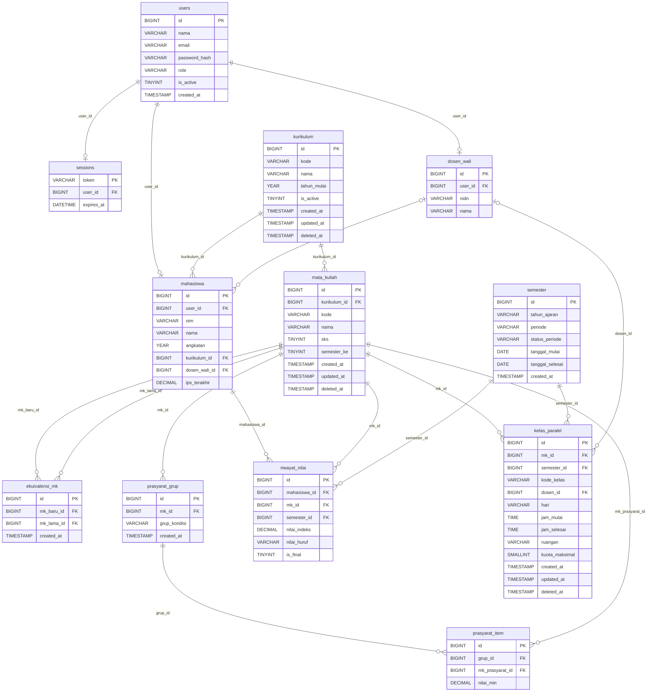

# ERD (Bagian Master)

Diagram dibuat dari `db/schema.sql`. Tabel transaksi (`krs`, `krs_detail`, `daftar_tunggu`) ditambahkan oleh Shofwan pada ERD gabungan; relasi yang menuju ke sana diberi catatan di bawah diagram.

## Catatan relasi

- `users` 1—1 `mahasiswa` dan `users` 1—1 `dosen_wali` lewat `user_id`; Admin Prodi hanya punya baris di `users`.
- `ekuivalensi_mk` menghubungkan dua baris `mata_kuliah` (`mk_baru_id` dan `mk_lama_id`).
- `prasyarat_grup` → `prasyarat_item`: tepat dua tingkat (grup AND/OR di atas butir MK), tanpa nesting.
- `kelas_paralel.dosen_id` menunjuk `dosen_wali.id`.
- Tabel transaksi menunjuk ke tabel ini: `krs.mahasiswa_id`/`semester_id`, `krs_detail.kelas_paralel_id`, `daftar_tunggu.mahasiswa_id`/`kelas_paralel_id`.
