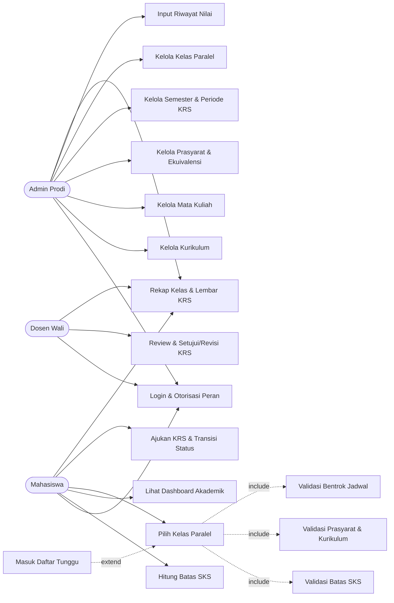

# Kompilasi Desain KRSync — Tahap 1

Disusun oleh Shofwan dari dokumen sumber tim.
Dibuat ulang dengan `make design` (lengkap) atau `make design-draft`.

> **DRAFT — design freeze belum selesai.** Menunggu: state-diagram.md erd.md kamus-data.md.

---

## Dokumen: use-case

Sumber: [use-case.md](use-case.md).

# Use Case Diagram — KRSync Tahap 1

Tiga aktor: **Admin Prodi**, **Mahasiswa**, **Dosen Wali**. Diagram di bawah
memetakan FR-01 s.d. FR-17 ke use case. Relasi `include` berarti sub-proses
selalu dijalankan; `extend` berarti sub-proses hanya berjalan pada kondisi
tertentu (kuota penuh).

## Diagram

Arah panah `extend` selalu **dari use case yang memperluas menuju use case
dasar**: `Masuk Daftar Tunggu` (UC14) memperluas `Pilih Kelas Paralel` (UC10),
bukan sebaliknya.

## Daftar Kebutuhan Fungsional

| FR | Kebutuhan Fungsional | Aktor utama |
|---|---|---|
| FR-01 | Login dan otorisasi berbasis peran untuk tiga aktor | Admin, Mahasiswa, Dosen |
| FR-02 | Kelola data kurikulum (CRUD) | Admin Prodi |
| FR-03 | Kelola data mata kuliah (CRUD) | Admin Prodi |
| FR-04 | Kelola prasyarat gabungan (AND/OR) dan ekuivalensi mata kuliah | Admin Prodi |
| FR-05 | Kelola semester dan status periode KRS | Admin Prodi |
| FR-06 | Kelola kelas paralel: jadwal, ruangan, dan kuota | Admin Prodi |
| FR-07 | Input dan ubah riwayat nilai mahasiswa | Admin Prodi |
| FR-08 | Hitung batas SKS dari IPS terakhir | Mahasiswa (otomatis) |
| FR-09 | Tampilkan dashboard akademik: IPS, batas SKS, status KRS | Mahasiswa |
| FR-10 | Pilih dan batalkan kelas paralel pada KRS | Mahasiswa |
| FR-11 | Validasi batas SKS saat memilih kelas | Mahasiswa (otomatis) |
| FR-12 | Validasi prasyarat dan kurikulum | Mahasiswa (otomatis) |
| FR-13 | Validasi bentrok jadwal | Mahasiswa (otomatis) |
| FR-14 | Masuk daftar tunggu saat kuota kelas penuh | Mahasiswa (otomatis) |
| FR-15 | Ajukan KRS dan jalankan transisi status | Mahasiswa |
| FR-16 | Review, setujui, atau minta revisi KRS | Dosen Wali |
| FR-17 | Rekap kelas prodi dan lembar KRS siap cetak | Admin, Mahasiswa, Dosen |

## Pemetaan FR ke Use Case

| Use case | FR |
|---|---|
| UC01 Login & Otorisasi Peran | FR-01 |
| UC02 Kelola Kurikulum | FR-02 |
| UC03 Kelola Mata Kuliah | FR-03 |
| UC04 Kelola Prasyarat & Ekuivalensi | FR-04 |
| UC05 Kelola Semester & Periode KRS | FR-05 |
| UC06 Kelola Kelas Paralel | FR-06 |
| UC07 Input Riwayat Nilai | FR-07 |
| UC08 Hitung Batas SKS | FR-08 |
| UC09 Dashboard Akademik | FR-09 |
| UC10 Pilih Kelas Paralel | FR-10 |
| UC11 Validasi Batas SKS | FR-11 |
| UC12 Validasi Prasyarat & Kurikulum | FR-12 |
| UC13 Validasi Bentrok Jadwal | FR-13 |
| UC14 Masuk Daftar Tunggu | FR-14 |
| UC15 Ajukan KRS & Transisi Status | FR-15 |
| UC16 Review & Setujui/Revisi KRS | FR-16 |
| UC17 Rekap Kelas & Lembar KRS | FR-17 |

---

## Dokumen: crud-matrix

Sumber: [crud-matrix.md](crud-matrix.md).

# Matriks Hak Akses (CRUD Matrix)

Tabel ini menjadi acuan route dan middleware. `C` = create, `R` = read,
`U` = update, `D` = delete (soft delete untuk data master). Tanda `—` berarti
aktor tidak memiliki akses.

| Modul | Admin Prodi | Mahasiswa | Dosen Wali |
|---|---|---|---|
| Kurikulum | C R U D | R | R |
| Mata Kuliah | C R U D | R | R |
| Prasyarat / Ekuivalensi | C R U D | R | R |
| Kelas Paralel | C R U D | R | R |
| Riwayat Nilai | C R U D | R (sendiri) | R (bimbingan) |
| Pengisian KRS | R | C R U (DRAFT/REVISI) | R + setujui/revisi |
| Daftar Tunggu | R | R (sendiri) | R (bimbingan) |
| Rekap Kelas | R | — | R (bimbingan) |
| Semester / Periode | C R U | R | R |
| Pengguna / Akun | C R U (nonaktifkan) | — | — |

## Catatan penegasan

a. Data master (kurikulum, mata kuliah, prasyarat, ekuivalensi, kelas paralel,
   semester) memakai soft delete: setiap `SELECT` menyertakan
   `deleted_at IS NULL`.
b. Data transaksi (`krs`, `krs_detail`, `daftar_tunggu`) tidak pernah dihapus,
   hanya diubah statusnya.
c. Mahasiswa hanya dapat membaca baris miliknya sendiri; dosen hanya membaca
   mahasiswa bimbingannya. Pembatasan ini ditegakkan di service, bukan hanya di
   handler.
d. Admin Prodi tidak membuat atau menyetujui KRS; ia hanya membaca dan
   mengelola data master serta rekap.

---

## Dokumen: sitemap

Sumber: [sitemap.md](sitemap.md).

# Sitemap Halaman Web — KRSync Tahap 1

Setiap halaman dipetakan ke tepat satu route. Route mengikuti `PLAN.md`
(Task 13, 17, 18, 19, 20) dan didaftarkan di `cmd/web/main.go` (Task 1, 6, 13,
17, 18).

## Halaman bersama (sebelum login)

| Halaman | Route | Handler |
|---|---|---|
| Beranda | `GET /` | `halaman.Home` |
| Login | `GET /login`, `POST /login` | `authH.FormLogin`, `authH.Login` |
| Logout | `POST /logout` | `authH.Logout` |
| Aset statis | `GET /static/` | `http.FileServer("public")` |

## Menu Admin Prodi

| Halaman | Route |
|---|---|
| Dashboard Rekap Kelas dan Waitlist | `GET /admin/rekap` |
| Semester / Periode | `GET /admin/semester`, `POST /admin/semester` |
| Master Kurikulum | `GET /admin/kurikulum`, `POST /admin/kurikulum`, `GET /admin/kurikulum/{id}/edit`, `POST /admin/kurikulum/{id}/edit` |
| Master Mata Kuliah | `GET /admin/mk`, `POST /admin/mk`, `GET /admin/mk/{id}/edit`, `POST /admin/mk/{id}/edit` |
| Set Prasyarat dan Ekuivalensi | `GET /admin/prasyarat`, `POST /admin/prasyarat` |
| Jadwal dan Kuota Kelas Paralel | `GET /admin/kelas`, `POST /admin/kelas` |
| Input Nilai Mahasiswa | `GET /admin/nilai`, `POST /admin/nilai` |

## Menu Mahasiswa

| Halaman | Route |
|---|---|
| Dashboard Akademik (IPS dan jatah SKS) | `GET /krs` |
| Isi KRS dan Pilih Kelas | `GET /krs/isi`, `POST /krs/kelas`, `POST /krs/kelas/{id}/hapus` |
| Ajukan KRS | `POST /krs/ajukan` |
| Daftar Tunggu Saya | `GET /krs/tunggu` |
| Lembar KRS dan Riwayat Nilai | `GET /krs/lembar` |

## Menu Dosen Wali

| Halaman | Route |
|---|---|
| Daftar Mahasiswa Bimbingan | `GET /bimbingan` |
| Detail Review dan Persetujuan KRS | `GET /bimbingan/{id}` |
| Setujui KRS | `POST /bimbingan/{id}/setujui` |
| Minta Revisi KRS | `POST /bimbingan/{id}/revisi` |

## Celah yang ditemukan

a. **Pengguna / Akun (Admin Prodi)** ada di CRUD matrix tetapi tidak memiliki
   route maupun task handler di `PLAN.md`. Saat ini akun hanya dibuat lewat
   seed SQL (Task 21). Ini adalah task yang hilang bila halaman pengguna harus
   ada di Tahap 1.
b. **Riwayat Nilai mahasiswa** tidak punya route terpisah; kontrak Task 17
   menggabungkannya ke halaman Lembar KRS (`GET /krs/lembar`). Bila dosen atau
   mahasiswa butuh riwayat sebagai halaman sendiri, task tambahan diperlukan.
c. **Rekap Kelas untuk Dosen Wali** ada di CRUD matrix (`R bimbingan`) tetapi
   route `/admin/rekap` hanya untuk Admin Prodi. Task 19 tidak menyediakan
   route rekap per bimbingan.

---

## Dokumen: state-diagram

Sumber: [state-diagram.md](state-diagram.md).

**Menunggu draft pemilik dokumen.**

---

## Dokumen: erd

Sumber: [erd.md](erd.md).

**Menunggu draft pemilik dokumen.**

---

## Dokumen: kamus-data

Sumber: [kamus-data.md](kamus-data.md).

**Menunggu draft pemilik dokumen.**
