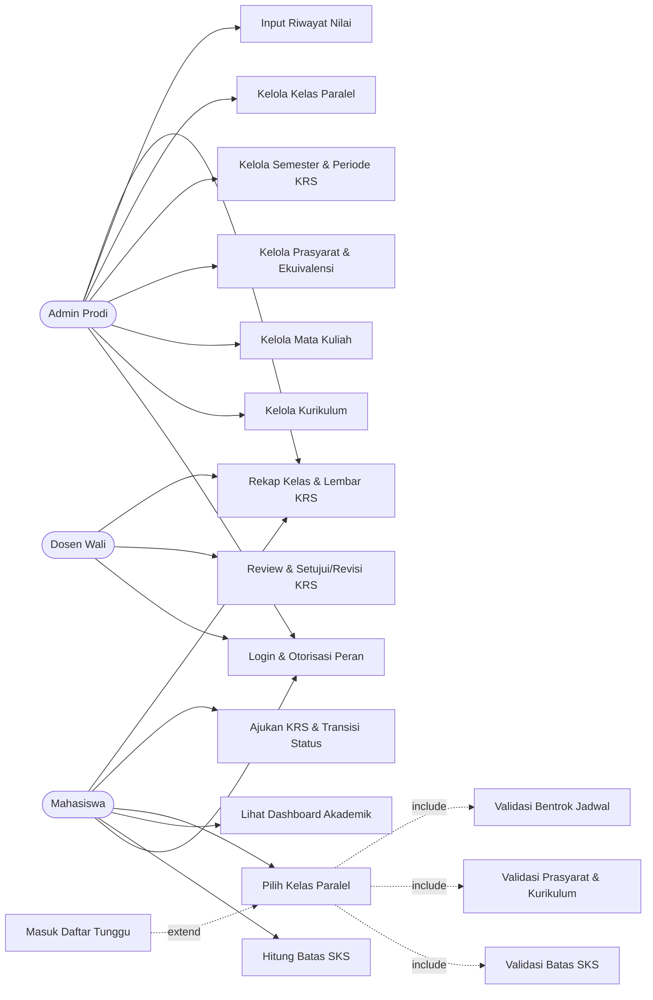

# Use Case Diagram — KRSync Tahap 1

Tiga aktor: **Admin Prodi**, **Mahasiswa**, **Dosen Wali**. Diagram di bawah
memetakan FR-01 s.d. FR-17 ke use case. Relasi `include` berarti sub-proses
selalu dijalankan; `extend` berarti sub-proses hanya berjalan pada kondisi
tertentu (kuota penuh).

## Diagram

Arah panah `extend` selalu **dari use case yang memperluas menuju use case
dasar**: `Masuk Daftar Tunggu` (UC14) memperluas `Pilih Kelas Paralel` (UC10),
bukan sebaliknya.

## Daftar Kebutuhan Fungsional

| FR | Kebutuhan Fungsional | Aktor utama |
|---|---|---|
| FR-01 | Login dan otorisasi berbasis peran untuk tiga aktor | Admin, Mahasiswa, Dosen |
| FR-02 | Kelola data kurikulum (CRUD) | Admin Prodi |
| FR-03 | Kelola data mata kuliah (CRUD) | Admin Prodi |
| FR-04 | Kelola prasyarat gabungan (AND/OR) dan ekuivalensi mata kuliah | Admin Prodi |
| FR-05 | Kelola semester dan status periode KRS | Admin Prodi |
| FR-06 | Kelola kelas paralel: jadwal, ruangan, dan kuota | Admin Prodi |
| FR-07 | Input dan ubah riwayat nilai mahasiswa | Admin Prodi |
| FR-08 | Hitung batas SKS dari IPS terakhir | Mahasiswa (otomatis) |
| FR-09 | Tampilkan dashboard akademik: IPS, batas SKS, status KRS | Mahasiswa |
| FR-10 | Pilih dan batalkan kelas paralel pada KRS | Mahasiswa |
| FR-11 | Validasi batas SKS saat memilih kelas | Mahasiswa (otomatis) |
| FR-12 | Validasi prasyarat dan kurikulum | Mahasiswa (otomatis) |
| FR-13 | Validasi bentrok jadwal | Mahasiswa (otomatis) |
| FR-14 | Masuk daftar tunggu saat kuota kelas penuh | Mahasiswa (otomatis) |
| FR-15 | Ajukan KRS dan jalankan transisi status | Mahasiswa |
| FR-16 | Review, setujui, atau minta revisi KRS | Dosen Wali |
| FR-17 | Rekap kelas prodi dan lembar KRS siap cetak | Admin, Mahasiswa, Dosen |

## Pemetaan FR ke Use Case

| Use case | FR |
|---|---|
| UC01 Login & Otorisasi Peran | FR-01 |
| UC02 Kelola Kurikulum | FR-02 |
| UC03 Kelola Mata Kuliah | FR-03 |
| UC04 Kelola Prasyarat & Ekuivalensi | FR-04 |
| UC05 Kelola Semester & Periode KRS | FR-05 |
| UC06 Kelola Kelas Paralel | FR-06 |
| UC07 Input Riwayat Nilai | FR-07 |
| UC08 Hitung Batas SKS | FR-08 |
| UC09 Dashboard Akademik | FR-09 |
| UC10 Pilih Kelas Paralel | FR-10 |
| UC11 Validasi Batas SKS | FR-11 |
| UC12 Validasi Prasyarat & Kurikulum | FR-12 |
| UC13 Validasi Bentrok Jadwal | FR-13 |
| UC14 Masuk Daftar Tunggu | FR-14 |
| UC15 Ajukan KRS & Transisi Status | FR-15 |
| UC16 Review & Setujui/Revisi KRS | FR-16 |
| UC17 Rekap Kelas & Lembar KRS | FR-17 |
